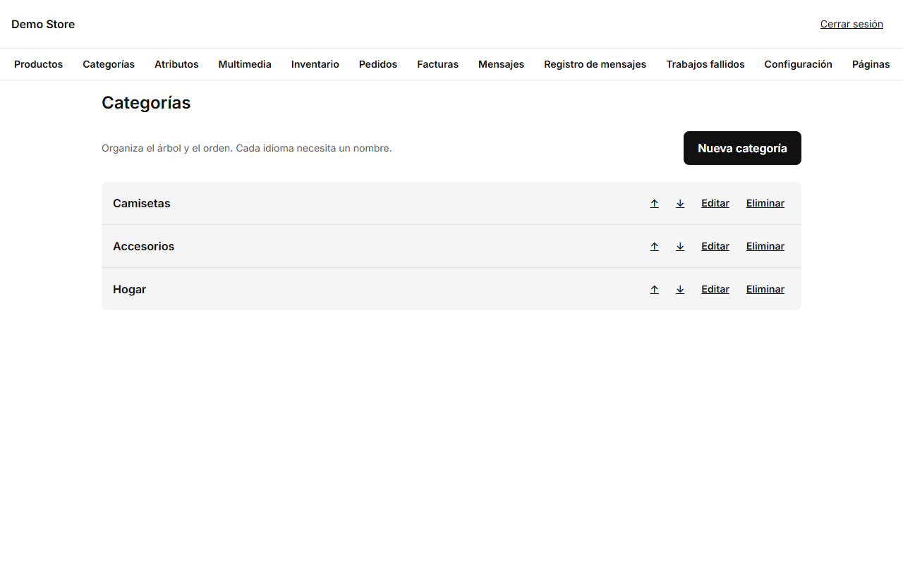
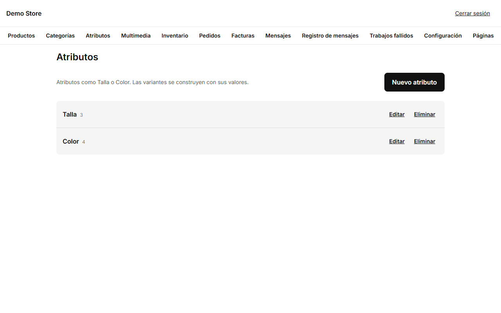
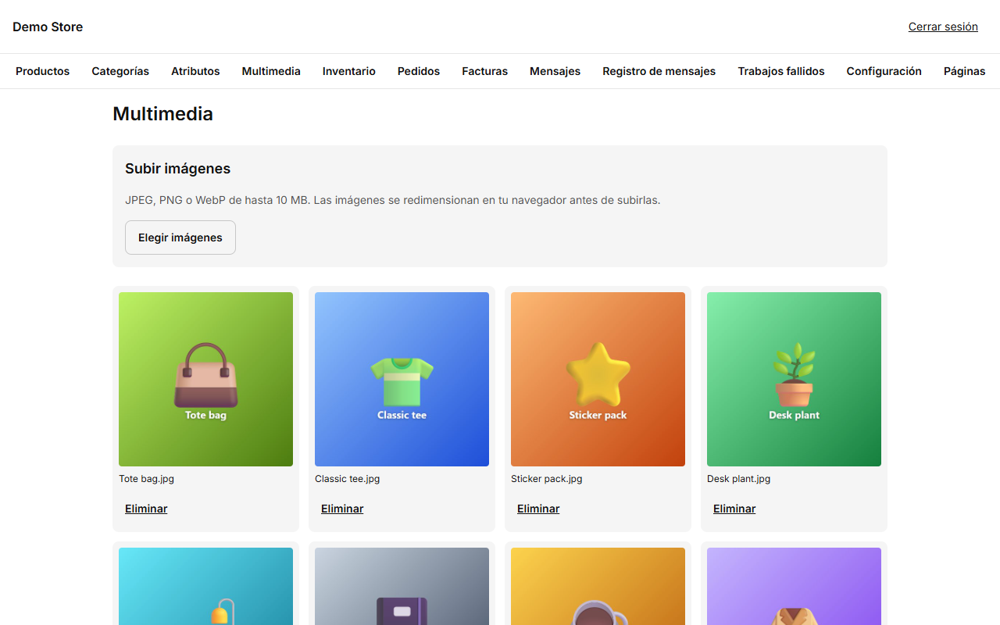

## Categorías

Las categorías agrupan los productos en el menú de la tienda y en la cuadrícula de la página de inicio. Cada una tiene nombre,
dirección (slug) y descripción en ambos idiomas, y un interruptor para mostrarla u ocultarla. Se organizan en árbol: una categoría
puede tener una **categoría padre**.

Usa el orden para poner primero las categorías más importantes. Una categoría oculta desaparece de la tienda, pero sus productos
siguen existiendo. Un producto puede estar en más de una categoría.

## Atributos

Los atributos son lo que diferencia a las variantes: **Talla**, **Color**, **Material**. Cada atributo tiene valores (S, M, L;
Negro, Blanco…). Un atributo se puede mostrar como **botones** o como **muestras de color**, y los colores llevan su tono para que
la tienda dibuje un punto de color.

Un atributo marcado como **Usar como filtro en la tienda** aparece en los filtros, con un contador junto a cada valor. Define los
atributos una vez y reutilízalos en todos los productos: así se puede filtrar toda la tienda por «Talla M».

## Multimedia

Cada imagen que subes se guarda aquí y se puede reutilizar en productos y categorías.

Se aceptan imágenes **JPEG, PNG o WebP de hasta 10 MB**. Al subir una imagen, el navegador prepara **varios tamaños** (480, 960 y
1600 px de ancho) antes de enviarla, de modo que los celulares descargan un archivo pequeño y los portátiles uno más nítido. Sube
imágenes de al menos 1000 px por el lado largo.

:::caution
No puedes eliminar una imagen que todavía usa un producto o una categoría. Quítala primero de donde se usa.
:::
