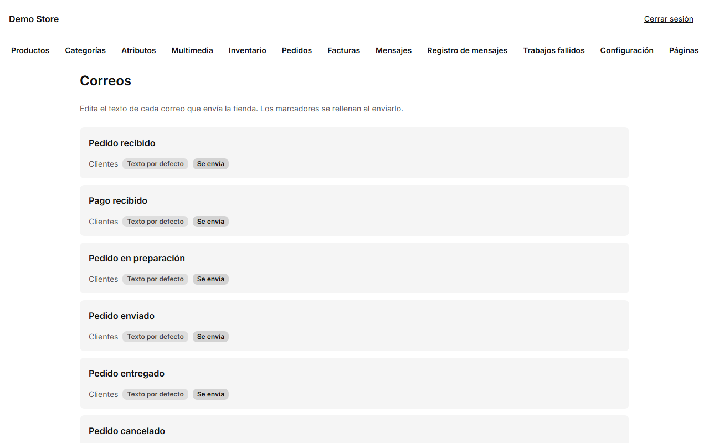
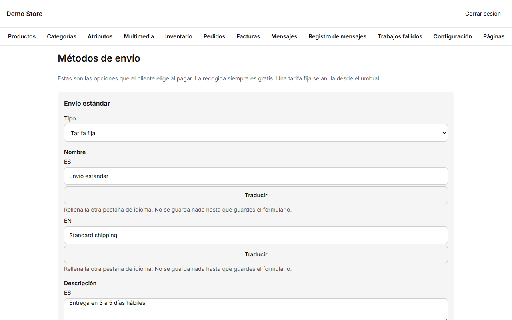

## Correos

**Correos** lista cada mensaje que envía la tienda, agrupado por quién lo recibe: **clientes** (pedido recibido, pago recibido,
pedido en preparación, enviado, entregado, cancelado, factura emitida, respuesta del formulario de contacto…), el **equipo de la
tienda** (pedido nuevo, mensaje de contacto nuevo, stock bajo…) y los **administradores** (restablecer contraseña, invitaciones).
Cada uno indica si usa el **texto por defecto** o uno **personalizado**, y si **se envía** o está **desactivado**.

Abre uno para cambiarlo:

1. Elige la pestaña del idioma (español o inglés) y edita el **asunto** y el **texto** (en Markdown).
2. Usa **marcadores** como el nombre del cliente o el número de pedido: pulsa uno para insertarlo en el texto. El editor ofrece los
   que ese correo admite y te avisa si usas uno que no existe.
3. La **vista previa** muestra el correo terminado con datos de ejemplo mientras escribes.
4. **Enviarme una prueba** manda el correo a tu dirección para verlo en una bandeja real (usa el texto guardado, así que guarda
   antes).
5. **Guardar**. **Restaurar por defecto** devuelve el texto estándar cuando quieras.

:::tip
Mantén los correos a clientes cortos y pon primero el siguiente paso: «Tu pedido va en camino, aquí tienes el código de
seguimiento».
:::

Solo los propietarios pueden **desactivar** los avisos que recibe la tienda; los correos a clientes siguen activos.

## Métodos de envío

**Envíos** contiene las opciones de entrega que ve el cliente al pagar.

Cada método tiene un **tipo**, un **nombre** y una **descripción** en ambos idiomas, una **posición** en la lista y un interruptor
(*Ofrecido al pagar* / *Oculto al pagar*).

- **Tarifa fija:** un solo precio por pedido. Puedes poner un importe **Gratis desde**: los pedidos iguales o superiores se envían
  gratis. Déjalo vacío para cobrar siempre esa tarifa.
- **Recogida:** siempre es gratis y no se pide dirección.

Usa la descripción para la promesa de entrega («Entrega en 3 a 5 días hábiles»). Los métodos ocultos desaparecen del pago, y los
pedidos antiguos que los usaron conservan sus datos.
