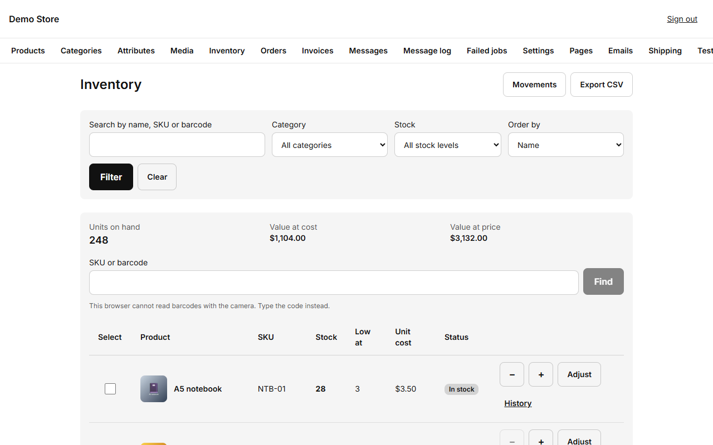
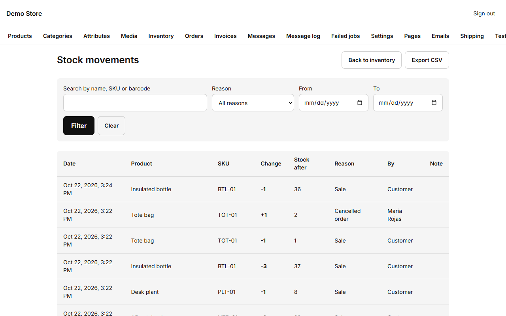

The inventory screen is the fastest way to see and change stock for every variant, without opening each product.

## Reading the screen

- **Units on hand, Value at cost, Value at price** at the top add up everything you currently hold, using each variant's cost and
  price.
- Filter by **name, SKU or barcode**, by **category**, or by **stock level** (all, in stock, low, out of stock), and sort by name
  or stock.
- Each row shows the stock, the **Low at** level (when the store warns you) and a status: *In stock*, *Low* or *Out*.
- **Find by SKU or barcode** jumps straight to a variant. On a phone, **Scan barcode** uses the camera where the browser supports
  it; otherwise type the code.

## Changing stock

- **− / +** change the stock by one.
- **Adjust** opens a panel where you either add or remove a quantity, or **set to a counted value** (what you counted on the
  shelf). Choose a **reason** (*Restock*, *Manual adjustment*, *Customer return* or *Damaged or lost*) and an optional note.
- Tick several rows and press **Adjust selected** to change many variants at once.
- **Import** reads a CSV file. It first shows a preview of what would change and any rows with problems, and nothing is saved until
  you confirm. **Export CSV** gives you the current list for a spreadsheet.

Sales and cancellations change stock automatically: an order takes stock when it is placed, and a cancelled or expired order puts
it back.

## Low and out-of-stock alerts

When a variant reaches its **low-stock level**, the store sends a single email listing all the variants that crossed the line (so
a big import does not flood your inbox). When a sold-out variant is restocked, shoppers who asked to be told are notified once.
The default low-stock level is set in [Settings](/admin/settings/) (Inventory) and can be changed per variant.

## History

Every change is recorded, forever: who made it, when, the reason, the quantity and the stock before and after. Open **History**
on a row for one variant, or **Movements** at the top for all of them.

Use it to answer "why is this number what it is?": a sale shows the order number, a manual change shows the person and the note.
Movements can be exported to CSV too.
