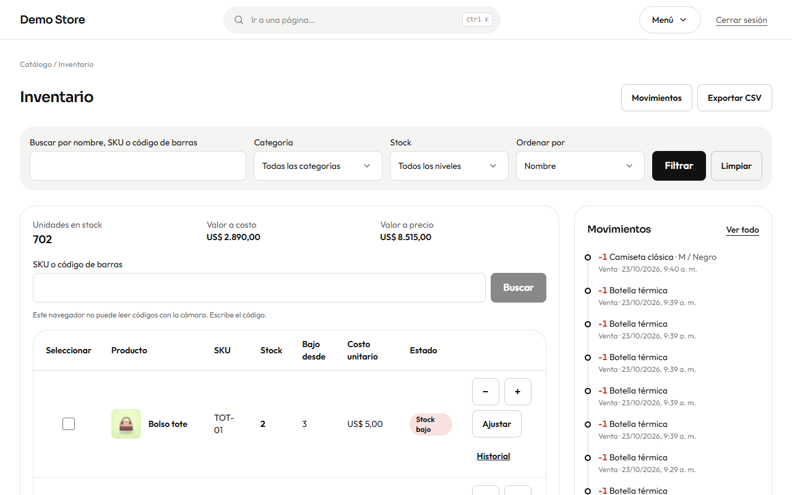
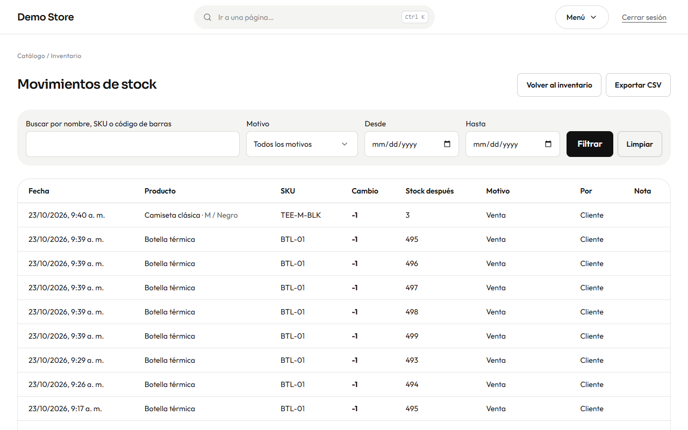

La pantalla de inventario es la forma más rápida de ver y cambiar el stock de todas las variantes, sin abrir cada producto.

## Leer la pantalla

- **Unidades en stock, Valor a costo y Valor a precio** arriba suman todo lo que tienes ahora, usando el costo y el precio de cada
  variante.
- Filtra por **nombre, SKU o código de barras**, por **categoría** o por **nivel de stock** (en stock, stock bajo, agotado, sin
  control de stock), y ordena por nombre, stock o valor.
- Cada fila muestra el stock, el nivel **Bajo desde** (cuando la tienda te avisa) y un estado: *En stock*, *Stock bajo* o *Agotado*.
- A la derecha de la tabla (debajo, en el celular) verás los **ocho últimos cambios de stock** como una línea de tiempo: cuántas
  unidades, qué producto, el motivo y cuándo. **Ver todo** abre el historial completo.
- **SKU o código de barras** te lleva directo a una variante. En el celular, **Escanear código** usa la cámara si el navegador lo
  permite; si no, escribe el código.

## Cambiar el stock

- **−** y **+** cambian el stock de una unidad en una unidad.
- **Ajustar** abre un panel donde puedes **sumar o restar unidades**, o **fijar a una cantidad contada** (lo que contaste en el
  estante). Elige un **motivo** (*Reposición*, *Ajuste manual*, *Devolución de cliente* o *Dañado o perdido*) y una nota opcional.
- Marca varias filas (hasta 50) y pulsa **Ajustar seleccionadas** para cambiar muchas variantes a la vez.
- **Importar una hoja de conteo:** sube un archivo CSV (hasta 2 MB) con las columnas `sku`, `mode` (`set` para fijar o `add` para
  sumar) y `quantity`, y opcionalmente el costo. Primero **Revisar archivo** muestra qué cambiaría y qué filas tienen problemas, y
  no se guarda nada hasta que pulses **Aplicar importación**. **Exportar CSV** te da la lista actual para una hoja de cálculo.

Las ventas y las cancelaciones cambian el stock solas: un pedido descuenta stock al crearse, y un pedido cancelado o vencido lo
devuelve.

## Alertas de stock bajo y agotado

Cuando una variante llega a su **nivel de stock bajo**, la tienda envía un solo correo con todas las variantes que cruzaron la línea
(así una importación grande no inunda tu bandeja). Cuando se repone una variante agotada, quienes pidieron que se les avisara reciben
un aviso una sola vez. El nivel por defecto se define en [Configuración](/admin/settings/) (Inventario) y se puede cambiar por
variante.

## Historial

Cada cambio queda registrado para siempre: quién lo hizo, cuándo, el motivo, la cantidad y el stock antes y después. Abre
**Historial** en una fila para ver una variante, o **Movimientos** arriba para verlas todas.

Úsalo para responder «¿por qué esta cifra es la que es?»: una venta muestra el número de pedido, un cambio manual muestra a la
persona y la nota. Los movimientos también se pueden exportar a CSV.
