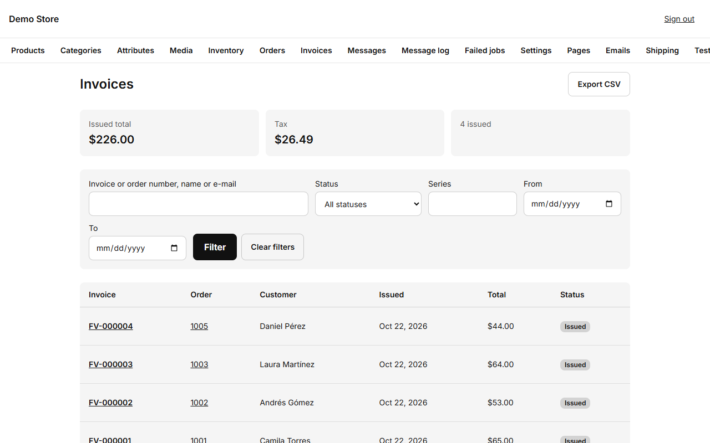
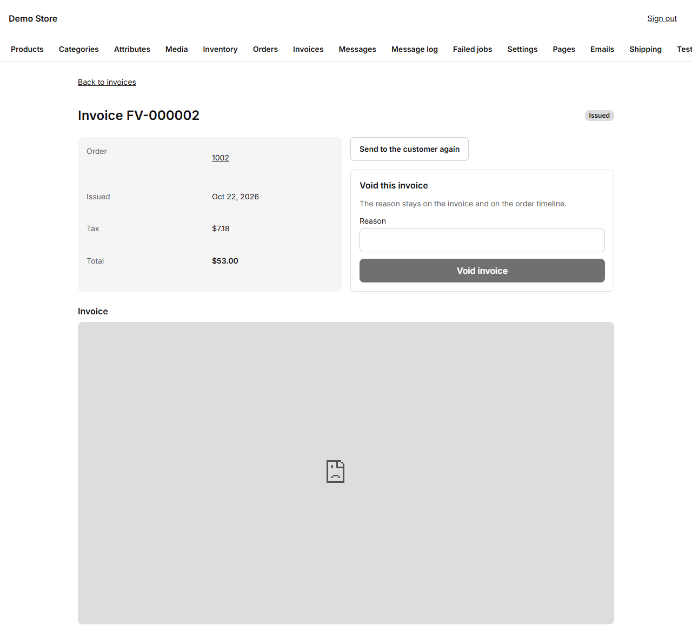

An invoice is created automatically when an order becomes **Paid**. It has a sequential number (for example `FV-000005`), the
seller's details from [Settings](/admin/settings/) (Invoicing), the customer's name and any company name and tax ID they gave at
checkout, each line, the tax breakdown and the totals.

The list shows every invoice with its number, date, customer, total and status. **Export CSV** gives your accountant the list
for a period.

## One invoice

- **View invoice** opens the printable page the customer sees.
- **Download PDF** saves the PDF.
- **Send invoice again** emails it to the customer.
- **Regenerate PDF** builds a fresh PDF, for example after you correct your company's details in Settings. The invoice number and
  amounts never change.
- **Void** cancels an invoice that was issued by mistake (**owners only**). A voided invoice stays in the list, marked as void, so
  the numbering has no gaps.

The PDF is prepared in the background a few seconds after the order is paid, and the email goes with it attached.

:::note[Tax rules differ by country]
The store issues its own invoice with the tax rate you set. If your country requires electronic invoicing approved by the tax
authority (for example DIAN in Colombia), the store is prepared to connect to one, but that link is set up separately for each
client. Ask the person who launched your store.
:::
