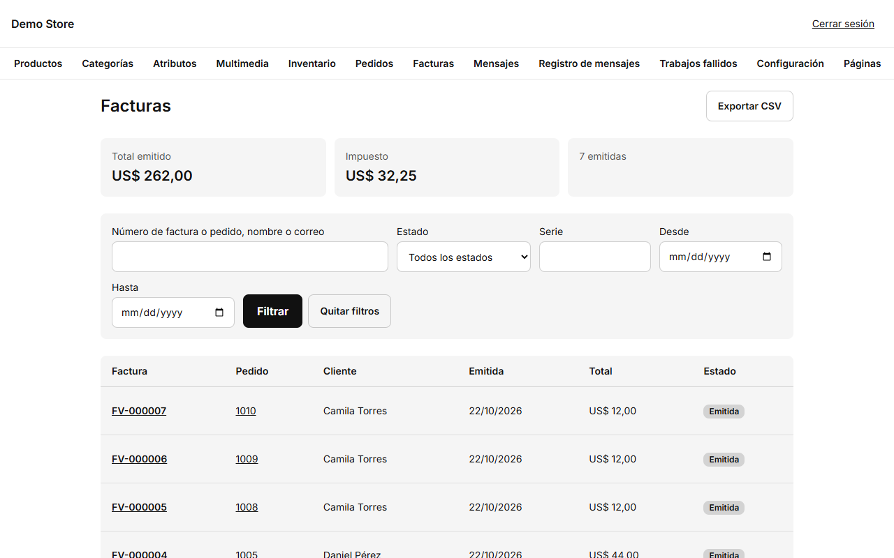

Una factura se crea sola cuando un pedido pasa a **Pagado**. Lleva un número consecutivo (por ejemplo `FV-000005`), los datos del
vendedor tomados de [Configuración](/admin/settings/) (Facturación), el nombre del cliente y la razón social e identificación
fiscal que dio al pagar, cada línea, el desglose de impuestos y los totales.

La lista muestra cada factura con su número, pedido, cliente, fecha, total, impuesto y estado (*Emitida* o *Anulada*), y puedes
filtrar por serie, estado o fechas. **Exportar CSV** le da a tu contador la lista de un periodo.

## Una factura

- **Ver factura** abre la página imprimible que ve el cliente.
- **Descargar PDF** guarda el PDF.
- **Enviar factura de nuevo** (o «Enviar de nuevo al cliente») la reenvía por correo.
- **Generar PDF de nuevo** crea un PDF nuevo, por ejemplo después de corregir los datos de tu empresa en Configuración. El número y
  los importes de la factura no cambian nunca.
- **Anular factura** cancela una factura emitida por error (**solo propietarios**). Hay que escribir un **motivo**, que queda en la
  factura y en el historial del pedido. Una factura anulada sigue en la lista, marcada como anulada, para que la numeración no tenga
  huecos.

El PDF se prepara en segundo plano unos segundos después de pagar el pedido, y el correo sale con él adjunto.

:::note[Las reglas fiscales cambian según el país]
La tienda emite su propia factura con la tasa de impuesto que configures. Si tu país exige facturación electrónica aprobada por la
autoridad fiscal (por ejemplo la DIAN en Colombia), la tienda está preparada para conectarse a un proveedor, pero esa conexión se
configura aparte para cada cliente. Pregunta a quien lanzó tu tienda.
:::
