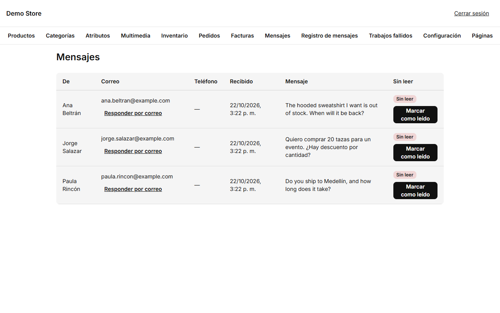
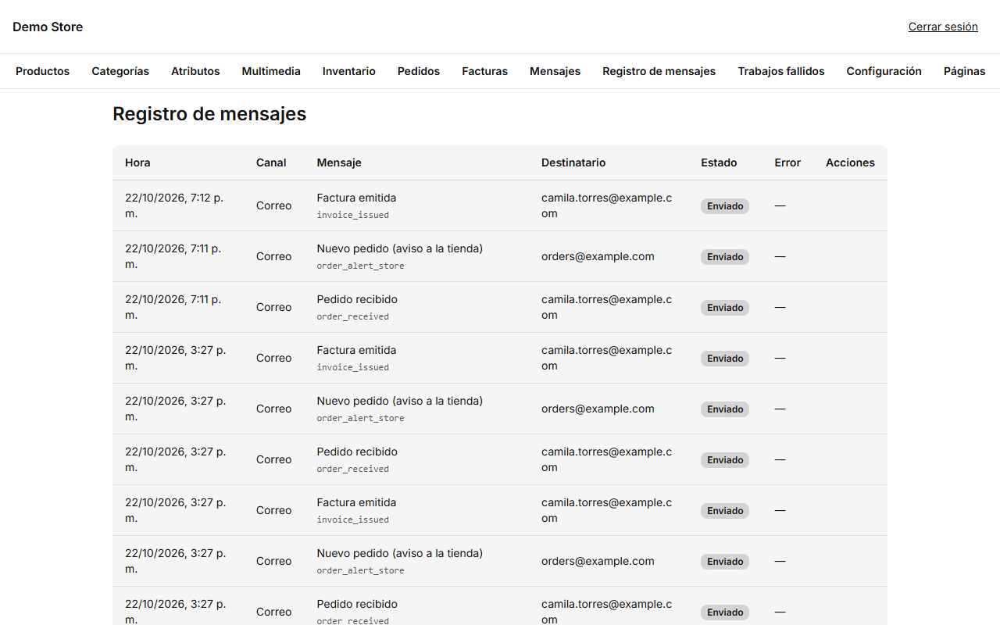
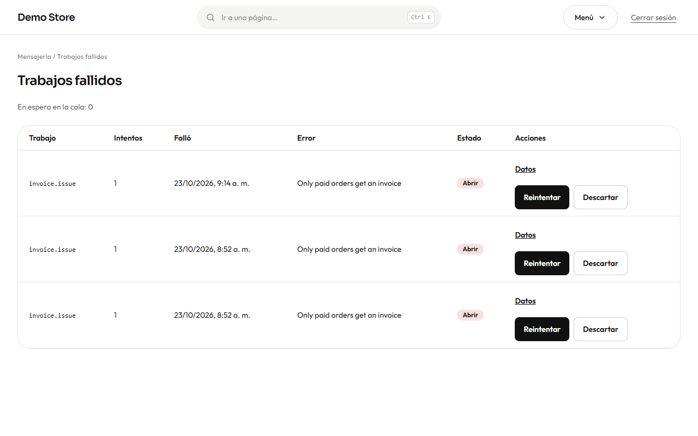

## Mensajes de contacto

:::note
La página de contacto de la tienda no tiene formulario ahora: la gente escribe por WhatsApp o por correo, y esos mensajes no pasan
por el panel. Esta lista solo se llena si la tienda vuelve a tener un formulario; hasta entonces estará vacía.
:::

Lo que alguien escriba en un formulario de contacto llega a **Mensajes**, el más reciente primero. El panel muestra cuántos están
sin leer.

- **Responder por correo** abre tu programa de correo dirigido a la persona (y **Responder por WhatsApp** si dejó su teléfono).
- **Marcar como leído** quita la marca de «sin leer» para que el contador del panel sea honesto.

La persona recibe automáticamente una respuesta breve de «recibimos tu mensaje», y el correo de la tienda recibe un aviso, ambos en
el idioma de la página desde la que escribió.

## El registro de mensajes

**Registro de mensajes** lista cada correo (y mensaje de WhatsApp) que la tienda intentó enviar: cuándo, por qué canal, qué
mensaje, a quién y en qué estado está: *En cola*, *Enviado*, *Entregado*, *Leído*, *Fallido* u *Omitido*.

Un mensaje puede **omitirse** a propósito, por ejemplo un WhatsApp a alguien que no lo aceptó; se muestra el motivo. Un mensaje
**fallido** tiene un botón **Enviar de nuevo** una vez que arreglaste la causa (casi siempre una dirección de remitente incorrecta o
una clave vencida). Solo los propietarios pueden reenviar.

:::tip
Cuando un cliente dice «no me llegó el correo», busca su dirección en el registro. Muestra si la tienda lo envió y cuándo.
:::

## Trabajos fallidos

Parte del trabajo ocurre en segundo plano: enviar un correo, generar el PDF de una factura, revisar alertas de stock. Si una tarea
sigue fallando después de varios reintentos automáticos, queda aparcada en **Trabajos fallidos** en lugar de perderse. Los
**propietarios** pueden **Reintentar** un trabajo cuando el problema está resuelto o **Descartarlo** cuando ya no importa. Arriba se
indica además cuántas tareas están **en espera en la cola**.

La tarjeta **Trabajos fallidos** del panel debería marcar **0**. Un número distinto significa que algo necesita atención.
