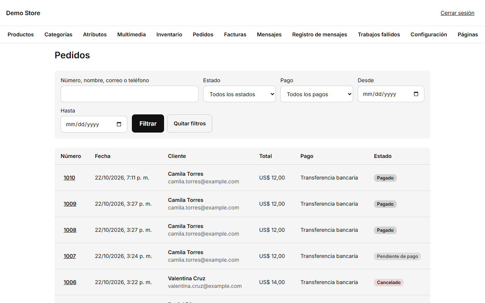
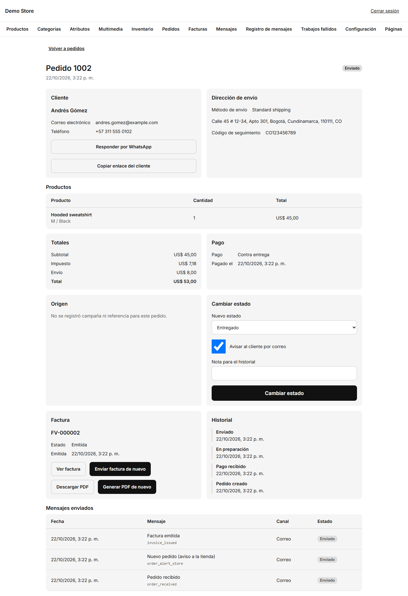

## La lista de pedidos

Busca por **número, nombre, correo o teléfono**, o filtra por **estado**, **método de pago** y un **rango de fechas**. Los pedidos
más nuevos aparecen arriba. Pulsa el número para abrir un pedido.

En el celular la lista se convierte en tarjetas, así que puedes gestionar pedidos desde el bolsillo.

## Un pedido

La página del pedido reúne todo en un solo lugar:

- **Cliente:** nombre, correo y teléfono, más **Responder por WhatsApp** (abre un chat con el cliente) y **Copiar enlace del
  cliente** (la página privada del pedido que ve el cliente).
- **Dirección de envío, método de envío y código de seguimiento.**
- **Productos, totales y pago:** lo comprado, el impuesto, el envío y cuándo se pagó.
- **Origen:** la campaña o referencia que trajo al cliente, cuando la tienda la registró.
- **Factura:** su número y estado, con botones para verla, enviarla de nuevo, descargar el PDF o generar el PDF de nuevo.
- **Historial:** cada paso con su hora.
- **Mensajes enviados:** cada correo o mensaje de WhatsApp de este pedido y si se entregó.

## Los estados del pedido

| Estado                  | Significado                                                                   | Quién lo cambia                                           |
| ----------------------- | ----------------------------------------------------------------------------- | --------------------------------------------------------- |
| **Pendiente de pago**   | El pedido se creó y espera el dinero.                                         | La tienda, al crear el pedido.                            |
| **Pagado**              | Llegó el dinero. Se emite una factura y se avisa al cliente.                  | Tarjeta y PayPal: automático. Transferencia, contra entrega y WhatsApp: tú. |
| **En preparación**      | Lo estás preparando.                                                          | Tú.                                                       |
| **Enviado**             | Salió de la tienda. Añade aquí el **código de seguimiento**.                  | Tú.                                                       |
| **Entregado**           | El cliente lo tiene.                                                          | Tú.                                                       |
| **Cancelado**           | El pedido no se hará. El stock reservado vuelve al estante.                   | Tú, o la tienda cuando vence un pago online.              |
| **Reembolsado**         | Devolviste el dinero fuera de la tienda. Esto solo lo registra.               | Tú.                                                       |

## Cambiar el estado

En **Cambiar estado**, elige el **nuevo estado**, añade si quieres una **nota para el historial** y decide si **avisar al cliente
por correo**. Para *Enviado* aparece el campo **Código de seguimiento**. Pulsa **Cambiar estado**.

:::tip[Una rutina para transferencias]
1. El pedido llega como **Pendiente de pago** y el cliente ve tus datos bancarios.
2. Cuando la transferencia aparece en tu banco, abre el pedido y ponlo en **Pagado**. Salen la factura y el correo de «pago
   recibido».
3. Prepáralo (**En preparación**), envíalo (**Enviado**, con el código de seguimiento) y márcalo como **Entregado**.
:::

:::caution
Los pedidos con tarjeta y PayPal los marca como **Pagados** el propio proveedor. No hace falta, y no conviene, marcarlos a mano.
Si un pago online no se confirma dentro del tiempo de reserva (45 minutos por defecto), el pedido vence y se libera el stock.
:::

## Reembolsos

Un reembolso de tarjeta se hace en el panel del proveedor (dLocal Go o PayPal). Cuando el proveedor confirma un reembolso total,
la tienda marca el pedido como **Reembolsado** por sí sola. Con los demás métodos, pon **Reembolsado** después de devolver el
dinero.
