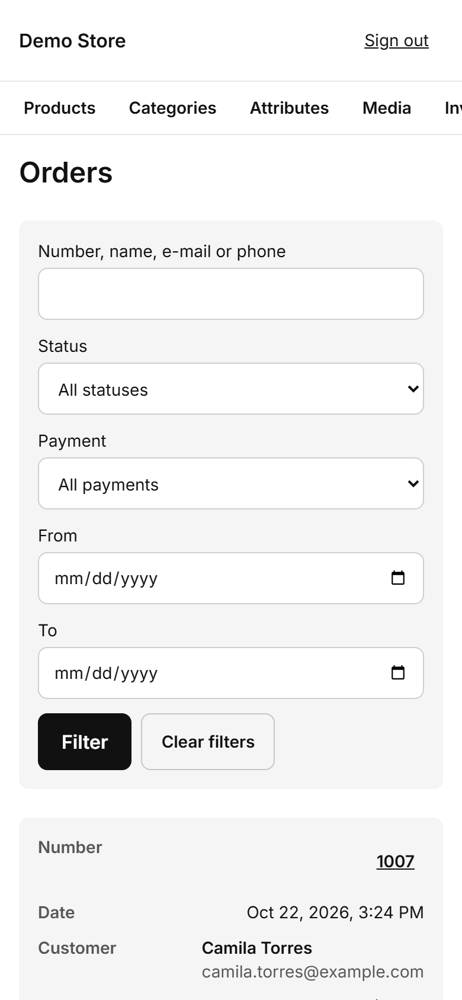
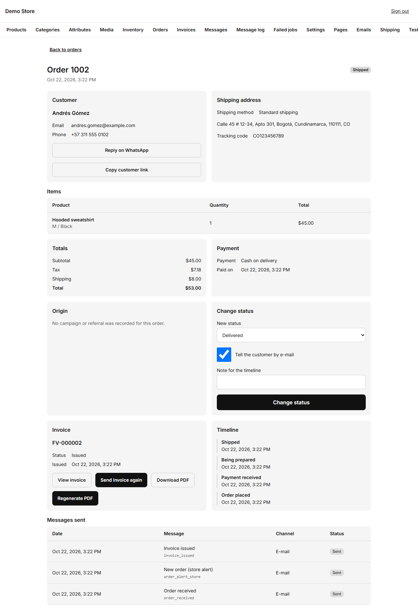

## The order list

Search by **order number, name, email or phone**, or filter by **status**, **payment method** and a **date range**. The newest
orders are on top. Click the number to open an order.

On a phone the list becomes cards, so you can process orders from your pocket.

## An order

The order page has everything in one place:

- **Customer:** name, email, phone, plus **Reply on WhatsApp** (opens a chat with the customer) and **Copy customer link** (the
  private order page the customer sees).
- **Shipping address, method and tracking code.**
- **Items, totals and payment:** what was bought, the tax, the shipping, and when it was paid.
- **Origin:** the campaign or referral that brought the customer, when the store recorded one.
- **Invoice:** its number and status, with buttons to view it, send it again, download the PDF or regenerate the PDF.
- **Timeline:** every step with its time.
- **Messages sent:** each email or WhatsApp message for this order and whether it was delivered.

## The order states

| State               | Meaning                                                                       | Set by                                   |
| ------------------- | ----------------------------------------------------------------------------- | ---------------------------------------- |
| **Pending payment** | The order is placed and waiting for the money.                                | The store, when the order is placed.     |
| **Paid**            | The money arrived. An invoice is issued and the customer is told.             | Card and PayPal: automatic. Bank transfer, cash on delivery and WhatsApp: you. |
| **Processing**      | You are preparing it ("Being prepared").                                      | You.                                     |
| **Shipped**         | It left the shop. Add the **tracking code** here.                             | You.                                     |
| **Delivered**       | The customer has it.                                                          | You.                                     |
| **Cancelled**       | The order will not happen. Reserved stock goes back to the shelf.             | You, or the store when an online payment expires. |
| **Refunded**        | You returned the money outside the store. This only records it.                | You.                                     |

## Changing the status

In **Change status**, choose the new state, optionally add a note for the timeline, and decide whether to **tell the customer by
email**. A **tracking code** field appears for *Shipped*. Press **Change status**.

:::tip[A routine for bank transfers]
1. The order arrives as **Pending payment** and the customer sees your bank details.
2. When the transfer appears in your bank, open the order and set **Paid**. The invoice and the "payment received" email go out.
3. Prepare it (**Processing**), ship it (**Shipped** with the tracking code), and mark it **Delivered**.
:::

:::caution
Card and PayPal orders are marked **Paid** by the payment provider on their own. You do not need to, and should not, mark them by
hand. If an online payment is not confirmed within the hold time (45 minutes by default), the order expires and the stock is
released.
:::

## Refunds

Refunding a card payment is done in the payment provider's dashboard (dLocal Go or PayPal). When the provider confirms a full
refund, the store marks the order **Refunded** by itself. For other methods, set **Refunded** after you return the money.
