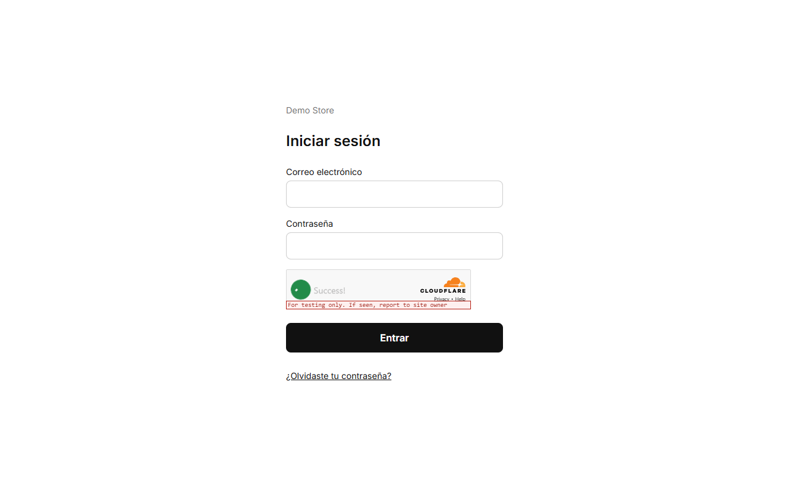
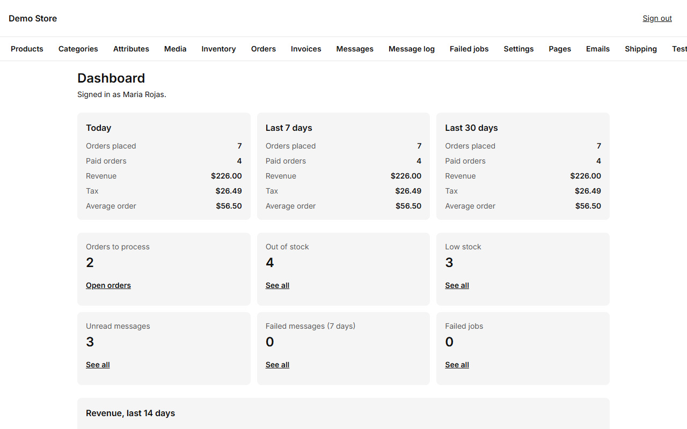
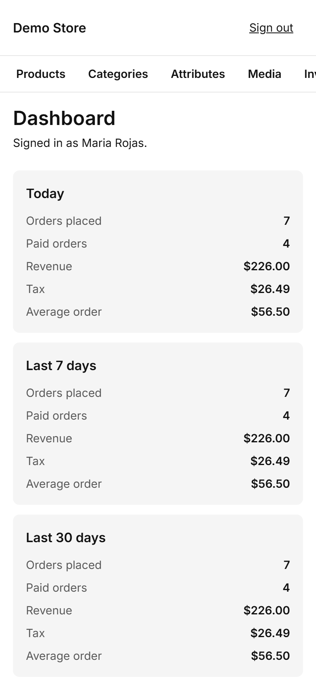

The admin is where the people who run the shop work. It lives at `/admin` on your store's address (for example
`https://your-shop.com/admin`) and works on a phone or a laptop.

## Signing in

Enter your email and password. If you forgot the password, choose **Forgot password** and the store emails you a link that is
valid for 30 minutes. There is a limit on sign-in attempts and a bot check, so guessing passwords does not work.

:::note[The very first time]
When a store is launched, the person who deploys it opens `/admin/setup` once, enters the setup code they were given, and creates
the first **owner** account. That page stops working as soon as an owner exists. See [Launching a store](/clients/launch/).
:::

## The dashboard

The first screen shows how the shop is doing right now.

- **Today, last 7 days, last 30 days:** orders placed, paid orders, revenue, tax and the average order.
- **Orders to process:** paid orders that still need preparing or shipping. Click **Open orders**.
- **Out of stock** and **Low stock:** products that need restocking.
- **Unread messages:** messages from the contact form.
- **Failed messages** and **Failed jobs:** emails or background tasks that did not go through. They should be **0**; see
  [Messages and notifications](/admin/messages-and-notifications/).
- A chart of revenue for the last 14 days.

On a phone the same cards stack in one column.

## The menu

The bar at the top has one entry per area: **Products, Categories, Attributes, Media, Inventory, Orders, Invoices, Messages,
Message log, Failed jobs, Settings, Pages, Emails, Shipping, Testimonials, Users, WhatsApp** and **Reports**. This guide follows
the same order.

## Roles: who can do what

There are two roles.

| Can…                                                        | Editor | Owner |
| ----------------------------------------------------------- | :----: | :---: |
| Manage products, categories, attributes and media           |   ✔    |   ✔   |
| Process orders and change their status                      |   ✔    |   ✔   |
| Adjust and import stock                                     |   ✔    |   ✔   |
| Edit pages, testimonials and email wording                  |   ✔    |   ✔   |
| Change **settings** (tax, checkout, payment, WhatsApp…)     |        |   ✔   |
| Void an invoice                                             |        |   ✔   |
| Invite and manage **users**                                 |        |   ✔   |
| Retry or discard failed jobs, connect **WhatsApp**          |        |   ✔   |

Give people the Editor role for daily work and keep the Owner role for the people who run the business. Permissions are checked
on the server, so a hidden button is never the only protection.
