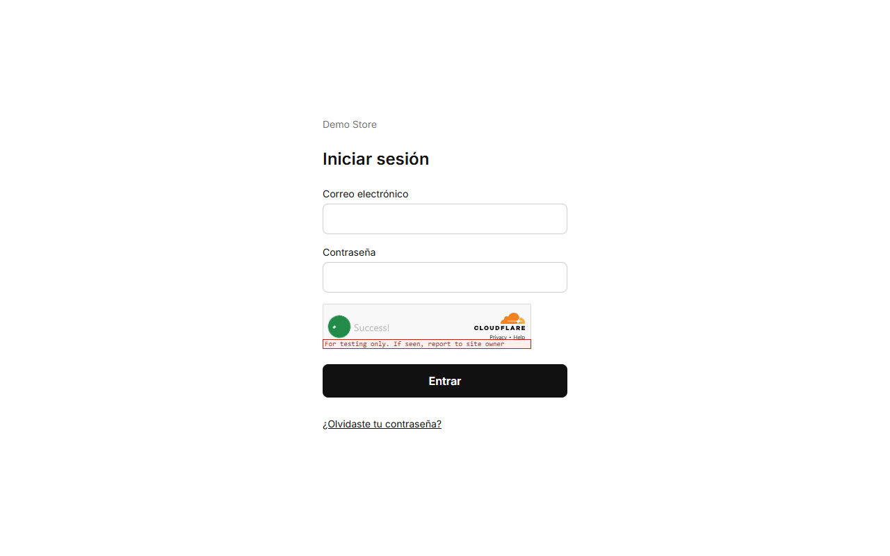
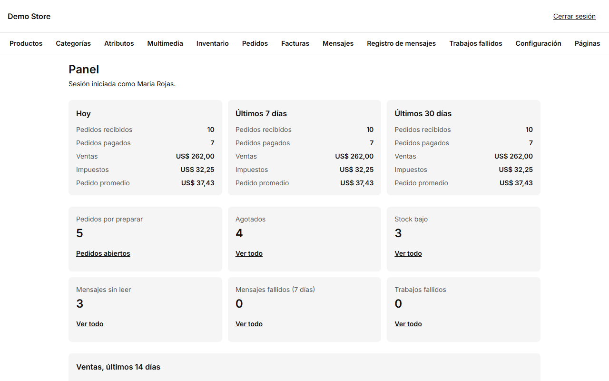
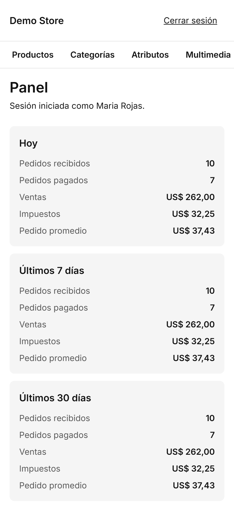

El panel es donde trabaja quien lleva la tienda. Está en `/admin` en la dirección de tu tienda (por ejemplo
`https://tu-tienda.com/admin`) y funciona en un celular o en un portátil.

## Iniciar sesión

Escribe tu correo y tu contraseña. Si la olvidaste, elige **¿Olvidaste tu contraseña?** y la tienda te envía un enlace válido
durante 30 minutos. Hay un límite de intentos y una comprobación anti-bots, así que adivinar contraseñas no funciona.

:::note[La primera vez]
Al lanzar una tienda, quien la publica abre `/admin/setup` una sola vez, escribe el código de configuración que recibió y crea la
primera cuenta de **propietario**. Esa página deja de funcionar en cuanto existe un propietario. Mira
[Lanzar una tienda](/clients/launch/).
:::

## El panel

La primera pantalla muestra cómo va la tienda ahora mismo.

- **Hoy, Últimos 7 días, Últimos 30 días:** pedidos recibidos, pedidos pagados, ventas, impuestos y pedido promedio.
- **Pedidos por preparar:** pedidos pagados que aún hay que preparar o enviar. Pulsa **Pedidos abiertos**.
- **Agotados** y **Stock bajo:** productos que hay que reponer.
- **Mensajes sin leer:** mensajes del formulario de contacto.
- **Mensajes fallidos** y **Trabajos fallidos:** correos o tareas que no salieron. Deberían estar en **0**; mira
  [Mensajes y notificaciones](/admin/messages-and-notifications/).
- Un gráfico con las ventas de los últimos 14 días y los productos más vendidos.

En el celular las mismas tarjetas se apilan en una columna.

## El menú

La barra superior tiene una entrada por área: **Productos, Categorías, Atributos, Multimedia, Inventario, Pedidos, Facturas,
Mensajes, Registro de mensajes, Trabajos fallidos, Configuración, Páginas, Correos, Envíos, Testimonios, Usuarios, WhatsApp** y
**Reportes**. Esta guía sigue el mismo orden.

## Roles: quién puede hacer qué

Hay dos roles.

| Puede…                                                             | Editor | Propietario |
| ------------------------------------------------------------------ | :----: | :---------: |
| Gestionar productos, categorías, atributos y multimedia            |   ✔    |      ✔      |
| Gestionar pedidos y cambiar su estado                              |   ✔    |      ✔      |
| Ajustar e importar stock                                           |   ✔    |      ✔      |
| Editar páginas, testimonios y el texto de los correos              |   ✔    |      ✔      |
| Cambiar la **configuración** (impuestos, pago, WhatsApp…)          |        |      ✔      |
| Anular una factura                                                 |        |      ✔      |
| Invitar y gestionar **usuarios**                                   |        |      ✔      |
| Reintentar o descartar trabajos fallidos, conectar **WhatsApp**    |        |      ✔      |

Da el rol de Editor para el trabajo diario y reserva el de Propietario para quienes dirigen el negocio. Los permisos se
comprueban en el servidor, así que un botón oculto nunca es la única protección.
