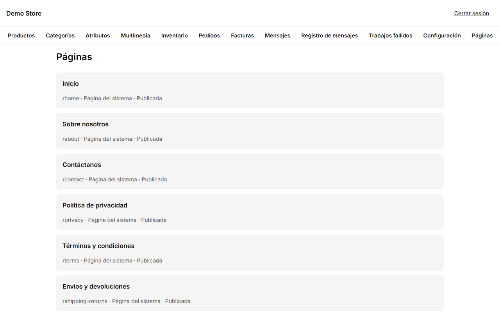
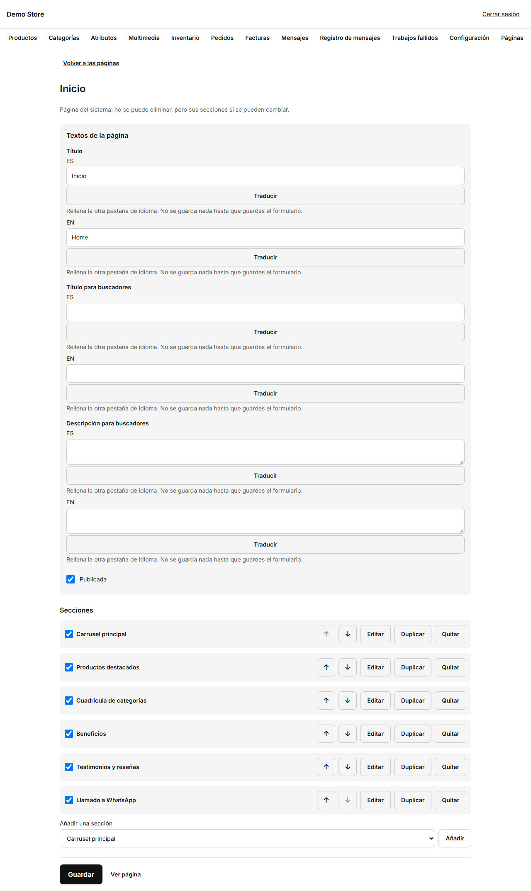
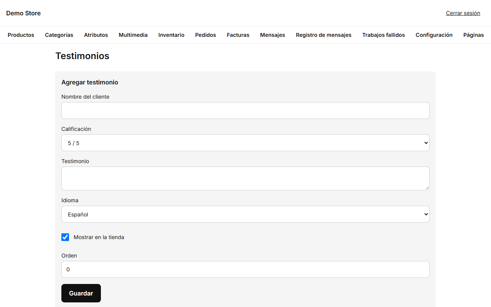

## Páginas

**Páginas** lista todas las páginas de la tienda que se componen de secciones.

- Las **páginas del sistema** existen en toda tienda y no se pueden eliminar: **Inicio, Nosotros, Contacto, Privacidad, Términos**
  y **Envíos y devoluciones**. Puedes cambiar lo que dicen y cómo están organizadas.
- Las **páginas propias** son tuyas: una guía de tallas, tu historia, una página para mayoristas. Créala con **Nueva página**,
  dale un título en ambos idiomas y una dirección (letras, números y guiones) y quedará, por ejemplo, en `/es/p/guia-de-tallas`.

## El editor de páginas

Abre una página para editarla.

**Textos de la página** guarda el título y los textos que muestra Google (título y descripción para buscadores), cada uno en
español e inglés, y un interruptor **Publicada**.

Las **Secciones** son los bloques, mostrados de arriba abajo tal como los ve quien compra. De cada una puedes activarla o
desactivarla (la casilla), moverla con las flechas, **Editar** su contenido, **Duplicarla** o **Quitarla**. Añade una nueva desde
la lista del final y pulsa **Añadir**.

| Sección                       | Qué muestra                                                                 |
| ----------------------------- | --------------------------------------------------------------------------- |
| **Carrusel principal**        | Diapositivas grandes con título, subtítulo y un botón.                       |
| **Productos destacados**      | Una fila o cuadrícula de productos que eliges, o los marcados como *Destacado*. |
| **Cuadrícula de categorías**  | Mosaicos que llevan a las categorías.                                        |
| **Banner promocional**        | Un aviso destacado para una oferta o una campaña.                            |
| **Beneficios**                | Razones breves para comprar (pago seguro, envío rápido, devoluciones).        |
| **Testimonios y reseñas**     | Los testimonios que escribiste y, opcionalmente, reseñas de Google.           |
| **Galería**                   | Un conjunto de imágenes.                                                     |
| **Preguntas frecuentes**      | Preguntas y respuestas desplegables.                                         |
| **Llamado a WhatsApp**        | Un botón destacado que abre un chat.                                         |
| **Texto**                     | Texto libre con títulos, listas y enlaces (Markdown).                         |

Pulsa **Guardar** y luego **Ver página** para verla. La página de inicio es una página como cualquier otra, así que reorganizarla es
cuestión de mover secciones.

## Testimonios

Los **Testimonios** son citas breves de clientes contentos. Agrega el nombre del cliente, una calificación de 1 a 5, el texto y el
idioma, elige el orden y decide si se muestra en la tienda.

Aparecen en la sección *Testimonios y reseñas* de cualquier página que la incluya. Muestra solo opiniones reales: mantiene la
confianza de tus clientes y, en muchos países, es una obligación legal.
