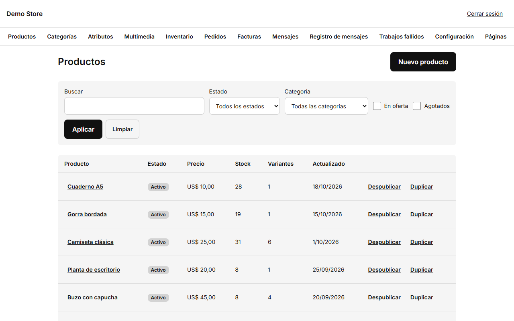
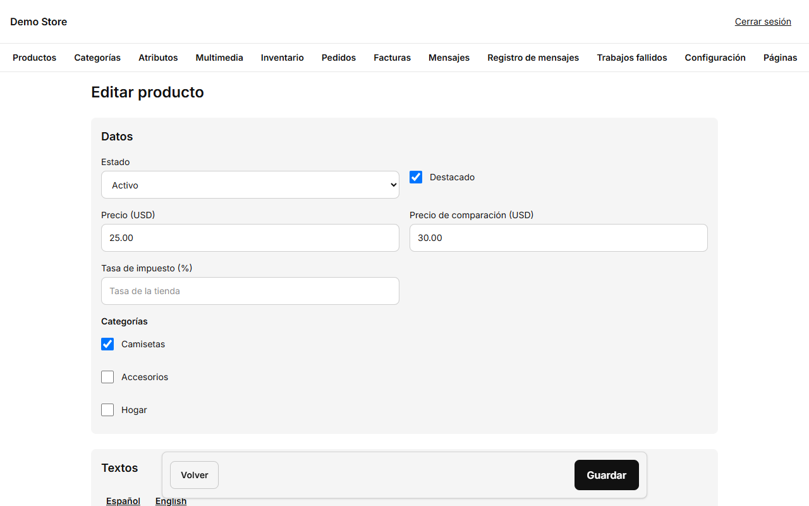

## La lista de productos

Encuentra productos con el buscador o con los filtros **Estado**, **Categoría**, **En oferta** y **Agotados**. Cada fila muestra el
estado, el precio, el stock total, el número de variantes y cuándo se cambió por última vez. En cada fila hay dos acciones
rápidas:

- **Despublicar / Publicar:** oculta un producto de la tienda sin borrarlo.
- **Duplicar:** empieza un producto nuevo a partir de uno existente (útil para artículos parecidos).

Pulsa **Nuevo producto** para crear uno.

## Editar un producto

**Datos**

- **Estado:** *Borrador* (no visible), *Activo* (a la venta) o *Archivado* (guardado pero oculto).
- **Destacado:** muestra el producto en los bloques de destacados de la página de inicio.
- **Precio** y **Precio de comparación:** el de comparación es el precio anterior que aparece tachado cuando haces una oferta. El
  dinero se escribe en la moneda de la tienda, por ejemplo `25.00`.
- **Tasa de impuesto (%):** déjala vacía para usar la tasa de la tienda, o pon otra (por ejemplo 0 % para un artículo exento).
- **Categorías:** marca una o varias. Si aún no hay, crea primero una categoría.

**Textos** tiene una pestaña por idioma. Escribe el nombre, la descripción corta y una descripción más larga en Markdown (puedes
usar `**negrita**`, listas y enlaces). El **slug** es la dirección web del producto en ese idioma; si lo dejas vacío se genera
desde el nombre. **Título SEO** y **Descripción SEO** son lo que muestra Google; si los dejas vacíos la tienda escribe unos
razonables.

**Imágenes:** agrégalas desde la biblioteca y reordénalas con las flechas. La primera es la imagen principal del producto y la que
aparece en los listados y al compartir un enlace.

## Opciones (variantes)

Muchos productos vienen en tallas o colores. Cada combinación es una **variante** con su propio SKU, código de barras, stock y,
si hace falta, su propio precio.

1. En **Generar variantes desde atributos**, marca los valores que vendes (por ejemplo tallas S, M, L y colores Negro, Blanco).
2. Pulsa **Generar variantes**. La tienda crea todas las combinaciones.
3. Rellena cada variante: **SKU** (tu código), **Código de barras**, **Stock**, **Costo** (lo que te cuesta; se usa en el valor
   del inventario y en los reportes), un **Precio** opcional si esa opción cuesta más, una **Alerta de stock bajo** y una imagen
   opcional.
4. **Controlar stock** activa o desactiva el conteo de stock (desactívalo para servicios o productos bajo pedido).
   **Desactivar** oculta una variante sin perder su historial.

Un producto sin tallas ni colores tiene una sola variante («Producto simple»); el formulario la sigue mostrando para que pongas su
SKU y su stock.

Pulsa **Guardar**. El campo **Nota para los cambios de stock** al final se guarda con cualquier cambio de stock que hayas hecho,
de modo que el [historial del inventario](/admin/inventory/) muestre el motivo.

:::tip
Al guardar un producto se renuevan las páginas de la tienda que lo muestran. Abre la ficha en una ventana privada para ver
exactamente lo que ve quien compra.
:::

Las categorías, los atributos (tallas, colores) y las imágenes se preparan en [Categorías, atributos y multimedia](/admin/catalog-setup/).
