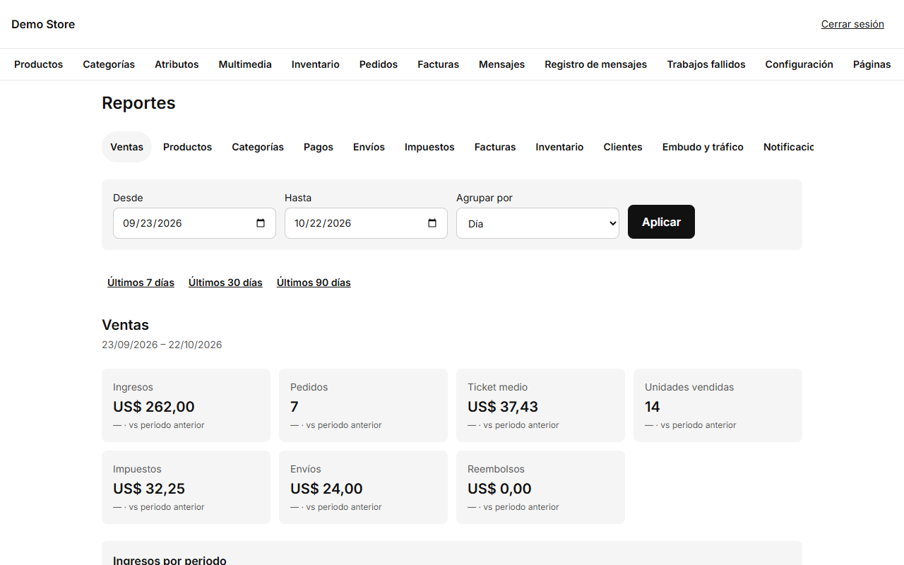

**Reportes** convierte tus pedidos, tu stock y tus visitas en números con los que puedes actuar.

## Elegir un reporte

Las pestañas de arriba son los reportes:

| Reporte                  | Responde a                                                              |
| ------------------------ | ----------------------------------------------------------------------- |
| **Ventas**               | Ingresos, pedidos, ticket medio, unidades, impuestos, envíos y reembolsos. |
| **Productos**            | Los más vendidos y los de baja rotación.                                |
| **Categorías**           | Qué partes del catálogo venden.                                         |
| **Pagos**                | Cómo pagan los clientes y cuánto aporta cada método.                    |
| **Envíos**               | Ingresos por envío y los métodos usados.                                |
| **Impuestos**            | El impuesto cobrado por tasa, para tu declaración.                      |
| **Facturas**             | Facturas emitidas y anuladas y sus totales.                             |
| **Inventario**           | Valor del stock, productos con stock bajo y agotados.                   |
| **Clientes**             | Clientes nuevos y recurrentes, y quién compra más.                      |
| **Embudo y tráfico**     | Visitas, vistas de producto, carritos y compras, y de dónde vienen.     |
| **Notificaciones**       | Correos y mensajes enviados, fallidos u omitidos.                       |

## Elegir el periodo

Define **Desde** y **Hasta**, o pulsa **Últimos 7 días**, **Últimos 30 días** o **Últimos 90 días**. En ventas puedes **agrupar
por** día, semana o mes. Cada cifra muestra cómo se compara con el periodo anterior («vs periodo anterior»). **Descargar CSV**
exporta la tabla del reporte, y cada reporte lleva al pie notas que explican cómo se cuenta (por ejemplo, que los importes cuentan
los pedidos el día en que se pagaron).

## Resumen semanal

La tienda puede enviarte por correo un resumen breve cada semana. Actívalo y elige el día y la hora en
[Configuración](/admin/settings/), en **Reportes**.

:::tip[Un hábito semanal sencillo]
Cada lunes: abre **Ventas** de los últimos 7 días, **Productos** para ver qué se vendió e **Inventario** para saber qué reponer.
Diez minutos bastan para detectar problemas a tiempo.
:::
