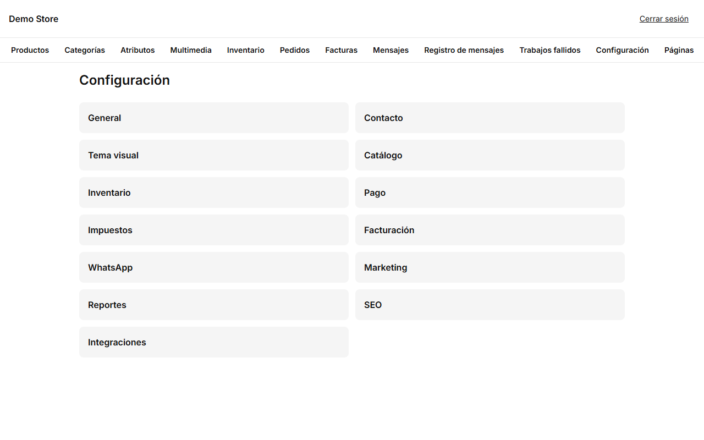
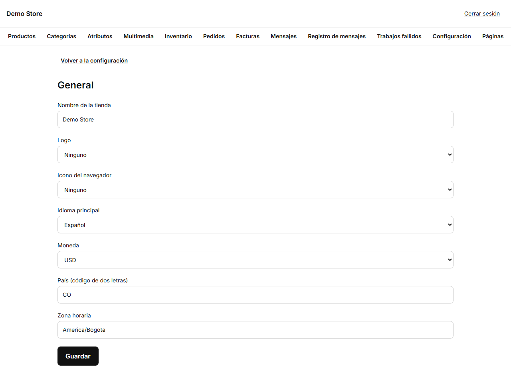
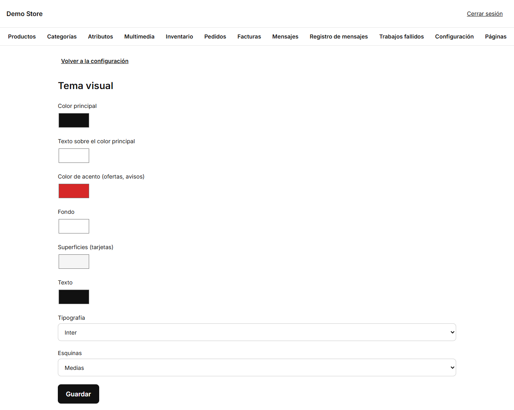
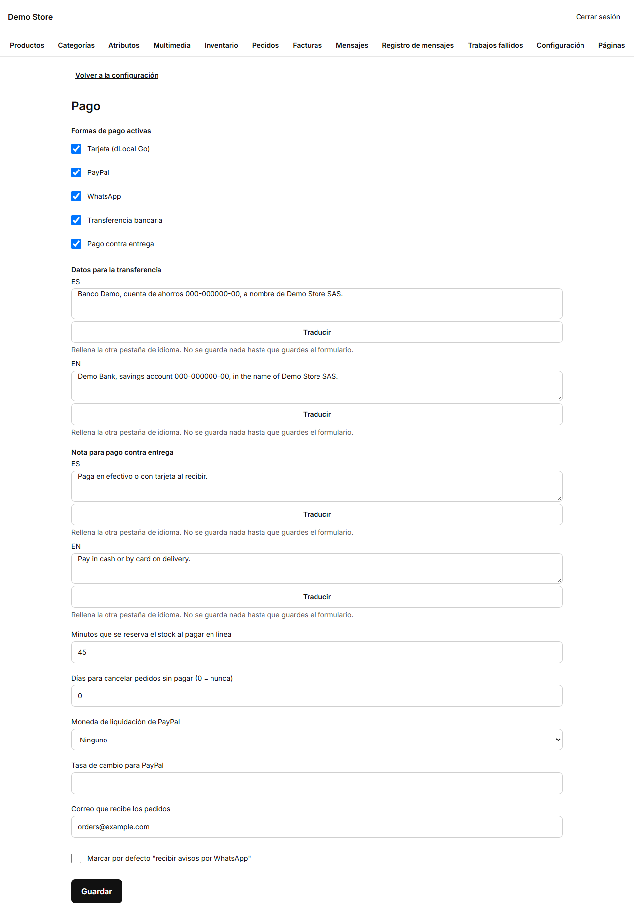

La configuración la cambian los **propietarios**. Cada grupo se guarda por separado y el cambio se ve en la tienda de inmediato.

| Grupo              | Qué controla                                                                                                                       |
| ------------------ | ---------------------------------------------------------------------------------------------------------------------------------- |
| **General**        | Nombre de la tienda, logo, icono del navegador, idioma principal, moneda, país y zona horaria.                                      |
| **Contacto**       | Correo, teléfono y dirección públicos, el número de WhatsApp y su mensaje por defecto, el botón flotante de WhatsApp y el mapa.     |
| **Tema visual**    | Colores, tipografía y lo redondeadas que son las esquinas.                                                                         |
| **Catálogo**       | Productos por página, cuántos días un producto cuenta como *Nuevo*, el orden por defecto, dónde aparecen los agotados y cuándo mostrar el stock. |
| **Inventario**     | El nivel de stock bajo por defecto, si se envían alertas de stock bajo (y por qué canal) y los avisos de «vuelve a haber stock».     |
| **Pago**           | Métodos de pago, textos de transferencia y contra entrega, cuánto tiempo se reserva el stock, cancelación automática de pedidos sin pagar y moneda de PayPal. |
| **Impuestos**      | El nombre y la tasa del impuesto (19 % por defecto), si tus precios ya lo incluyen, si el envío lleva impuesto y el desglose.       |
| **Facturación**    | Si se emiten facturas, la serie (por ejemplo `FV`) y la razón social, identificación fiscal, régimen, dirección y nota al pie.      |
| **WhatsApp**       | Si los mensajes de WhatsApp están activos, el número que recibe los avisos de la tienda y el código de país por defecto.            |
| **Marketing**      | El Pixel de Meta, la API de Conversiones, el catálogo de productos para anuncios y el modo del aviso de cookies.                    |
| **Reportes**       | El resumen semanal por correo (activo o no, día y hora) y cuántos días sin ventas hacen que un producto sea de «baja rotación».     |
| **SEO**            | El patrón del título de página (`%s` se sustituye por el nombre de la página), la descripción por defecto y la imagen al compartir. |
| **Integraciones**  | Las reseñas de Google (lugar) y el token de estadísticas de visitas de Cloudflare.                                                  |

## Lo primero que conviene configurar

1. **General:** nombre de la tienda, moneda y zona horaria.

   

2. **Impuestos** y **Facturación:** la tasa y los datos de tu empresa, y comprueba que la facturación esté activada, para que la
   primera factura salga bien.
3. **Contacto:** el correo y el WhatsApp que usarán los clientes.
4. **Tema visual:** los colores de tu marca.

   

   Elige el color principal para los botones, el de acento para las etiquetas de oferta y una de las tipografías (Inter, Manrope
   o Playfair Display). La tienda comprueba que los colores sean válidos, así que un error al escribir no puede romper el diseño.

5. **Pago:** elige los métodos de pago que aceptas y escribe tus datos bancarios y la nota de pago contra entrega en ambos idiomas.

   

   - **Minutos que se reserva el stock en un pago online:** cuánto tiempo conserva su stock un pedido de tarjeta o PayPal sin pagar
     (de 15 a 1.440).
   - **Días antes de cancelar pedidos sin pagar:** limpieza automática de transferencias que nadie pagó (`0` = nunca).
   - **Correo que recibe los pedidos:** adonde llega el aviso de «pedido nuevo».

:::note
Un método de pago solo funciona si sus claves están configuradas en el servidor (eso forma parte de
[lanzar la tienda](/clients/launch/)). Marcarlo aquí sin las claves muestra un error a quien compra, así que activa un método solo
cuando esté probado.
:::
