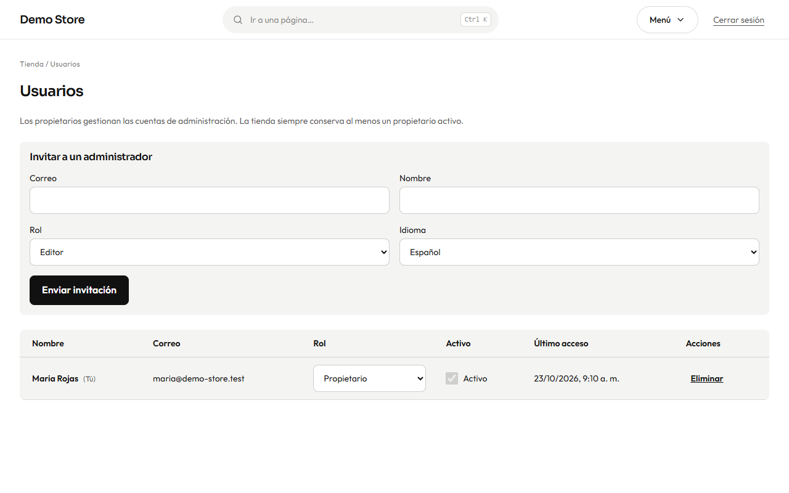
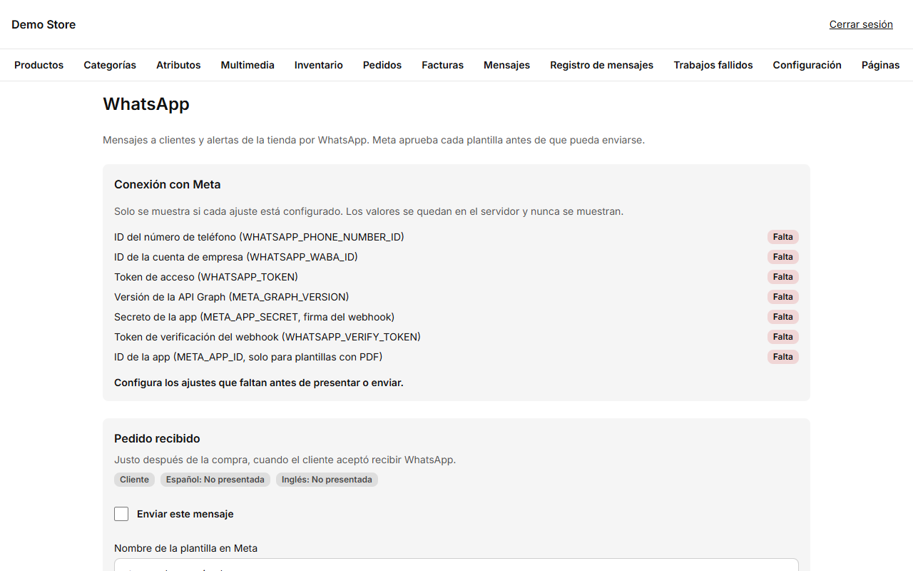

## Usuarios

**Usuarios** (solo propietarios) gestiona quién puede iniciar sesión.

Para añadir a alguien, rellena su **correo**, **nombre**, **rol** (Editor o Propietario) e **idioma**, y pulsa **Enviar
invitación**. Recibe un correo con un enlace para elegir su contraseña. Hasta que lo acepte, no puede iniciar sesión.

En la lista puedes cambiar el **rol** de una persona, desactivar **Activo** para que no pueda entrar sin borrar su historial, o
**Eliminar**. Dos reglas te protegen: la tienda siempre conserva **al menos un propietario activo**, y nadie puede cambiar su propio
rol ni desactivar su propia cuenta.

:::caution[Cuando alguien se va]
Desactiva su cuenta el mismo día. Su trabajo pasado queda en el historial, pero ya no puede iniciar sesión.
:::

## WhatsApp

WhatsApp puede llevar los mismos mensajes que el correo (pedido recibido, enviado, factura…) y los avisos de tu tienda. Usa la
plataforma oficial WhatsApp Business de Meta, lo que tiene dos consecuencias:

- Cada mensaje es una **plantilla que Meta aprueba** antes de poder enviarse.
- Un cliente recibe mensajes de WhatsApp solo si **lo aceptó** al pagar.

La pantalla **WhatsApp** (solo propietarios) es donde se gestiona.

1. **Conexión con Meta** lista los siete valores que necesita la conexión, cada uno marcado como *Configurado* o *Falta*. Los valores
   nunca se muestran; se guardan de forma segura en el servidor al lanzar la tienda. Mira la
   [configuración de WhatsApp](/clients/launch/#whatsapp-opcional) para saber cómo obtenerlos.
2. Debajo, cada mensaje tiene una tarjeta: el nombre de la plantilla, su estado en español e inglés (*No presentada*,
   *En revisión*, *Aprobada*, *Rechazada*…), un interruptor **Enviar este mensaje** y los botones **Presentar en Meta**,
   **Actualizar estado** y **Enviar prueba a mí**.
3. Un mensaje se envía solo cuando WhatsApp está activado en [Configuración](/admin/settings/), la conexión está completa, el
   mensaje está activado y Meta aprobó la plantilla en el idioma del cliente. Cualquier otro caso se registra como **Omitido**,
   con el motivo, en el [registro de mensajes](/admin/messages-and-notifications/).

La tienda también tiene un botón flotante de WhatsApp opcional y una opción de pago por WhatsApp; ambos funcionan sin la conexión con
Meta, porque simplemente abren un chat.
