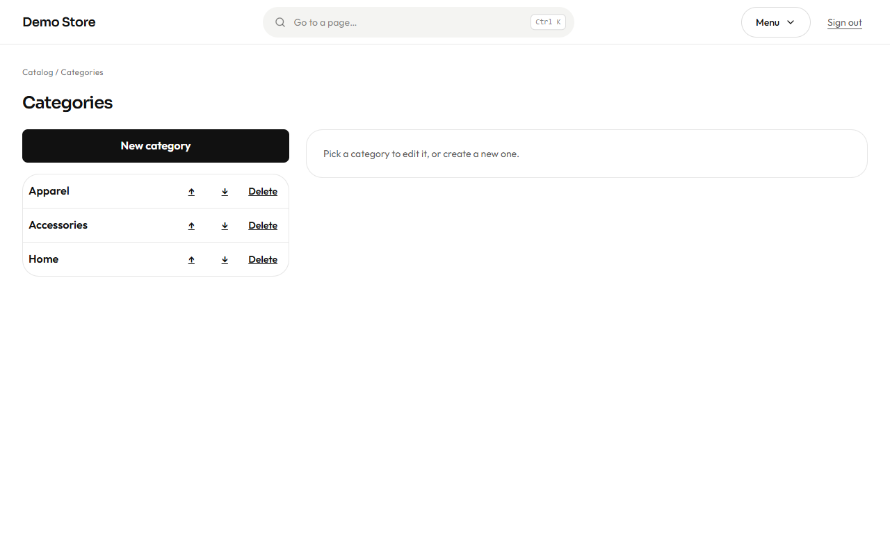
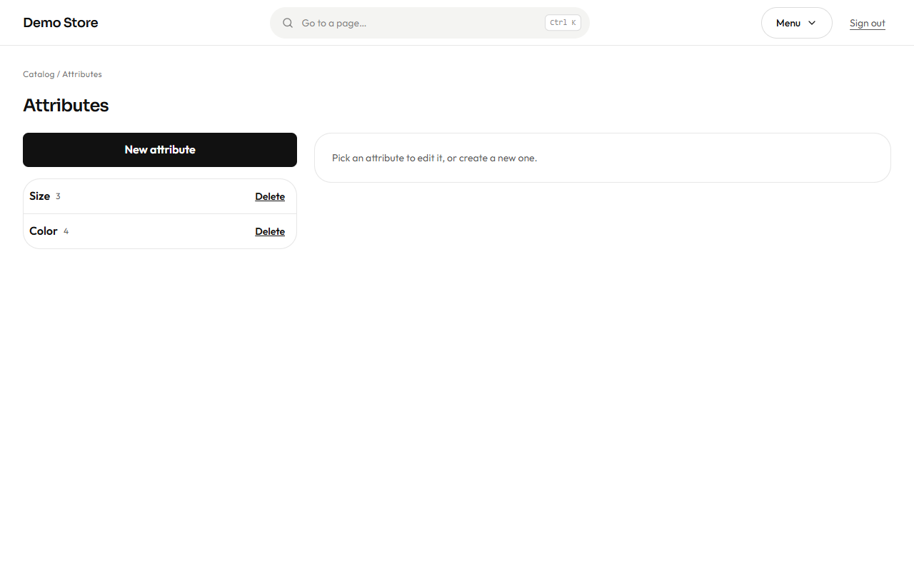
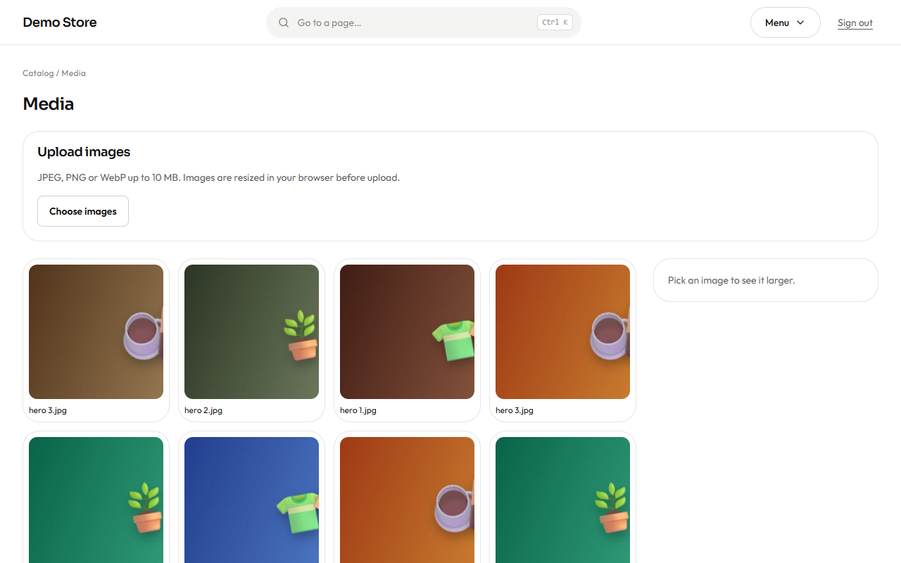

## Categories

Categories group products in the shop menu and on the home page grid. Each one has a name, address (slug) and description in
both languages, a position, and an on/off switch.

Categories are shown in two panes: the tree on the left and, on the right, the editor of the one you pick (or a new one with **New
category**). Use the arrows to put the most important categories first. A category that is switched off disappears from the shop, but its
products stay. A product can be in more than one category.

## Attributes

Attributes use the same layout: the list on the left and the editor on the right.

Attributes are the things that make variants different: **Size**, **Color**, **Material**. Each attribute has values (S, M, L;
Black, White…). Colours can have a swatch so the shop shows a coloured dot.

An attribute marked as **filterable** appears in the shop filters, with a count next to each value. Define attributes once and
reuse them across products; that is what lets a shopper filter the whole shop by "Size M".

## Media library

Every picture you upload is kept here and can be reused on products, categories and pages.

When you upload a picture, the browser makes **several sizes** of it (480, 960 and 1600 px wide) before sending it, so phones
download a small file and laptops a sharper one. JPEG, PNG and WebP pictures are accepted, up to 10 MB each. Upload pictures of at least 1000 px on the long side.

Pick a picture and it opens on the right, larger, with its name and the delete button. Right there you write its **alternative text**
in Spanish and in English (up to 200 characters each): it describes the picture for people who cannot see it, and it is what screen
readers and search engines read. The product page uses it as soon as you save; left empty in a language, the product's name is used.

:::caution
You cannot delete a picture that is still used by a product or a category. Remove it from there first.
:::
