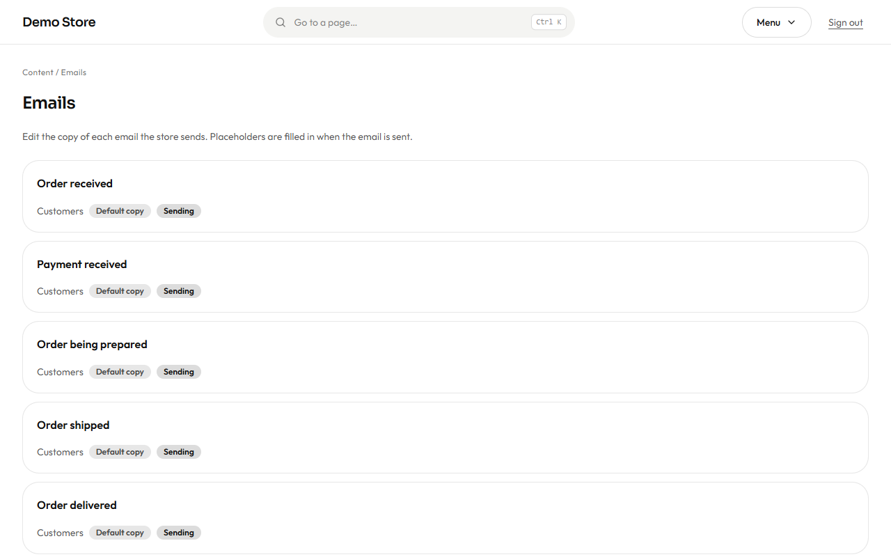
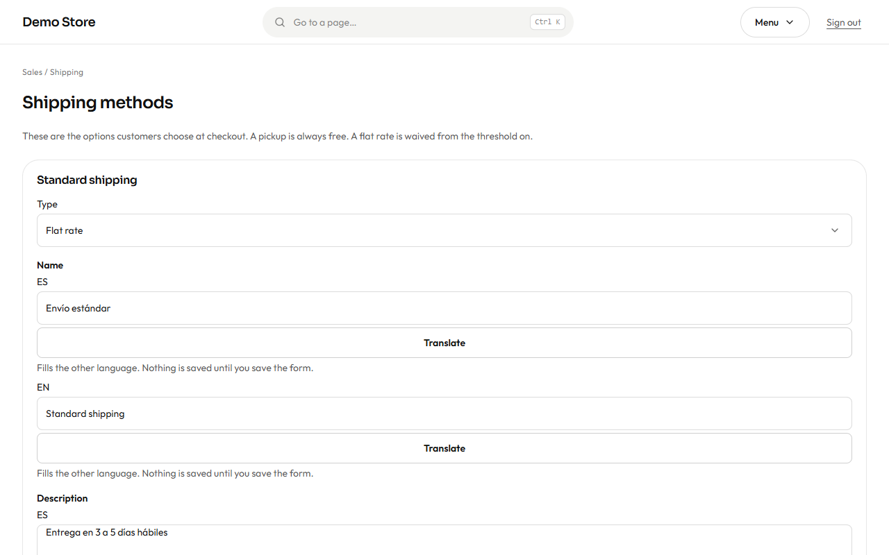

## Emails

**Emails** lists every message the store sends, grouped by who receives it: **customers** (order received, payment received,
being prepared, shipped, delivered, cancelled, invoice issued…) and **the store** (new order,
low stock…). Each shows whether it uses the **default copy** or **your copy**, and whether it is **sending** or turned off.

Open one to change it:

1. Choose the language tab (Spanish or English) and edit the **subject** and the **body**.
2. Use **placeholders** such as the customer's name or the order number. The editor offers the ones that email allows and warns
   you if you use one that does not exist.
3. The **preview** shows the finished email with sample data as you type.
4. **Send a test** to your own address to see it in a real inbox.
5. **Save**. **Restore** goes back to the standard wording whenever you want.

:::tip
Keep customer emails short and put the next step first: "Your order is on its way, here is the tracking code."
:::

Owners can also switch off the store's own alert emails; customer emails stay on.

## Shipping methods

**Shipping** holds the delivery options a customer sees at checkout.

Each method has a **type**, a **name** and a **description** in both languages, a **position** in the list and an on/off switch.

- **Flat rate:** one price for the whole order. You can set a **free-over amount**: orders at or above it ship free.
- **Pickup:** always free, and the shopper is not asked for an address.

Use the description for the delivery promise ("Delivered in 3 to 5 business days"). Methods that are switched off disappear from
checkout, but old orders that used them keep their details.
