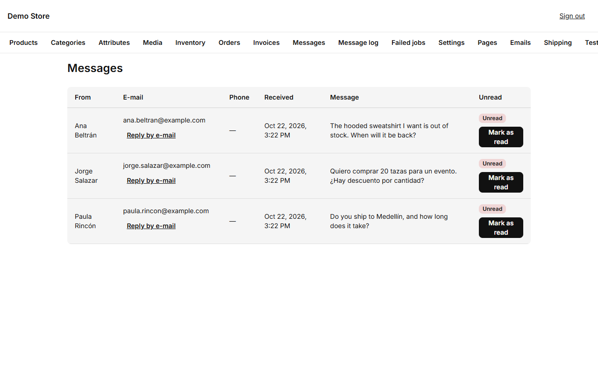
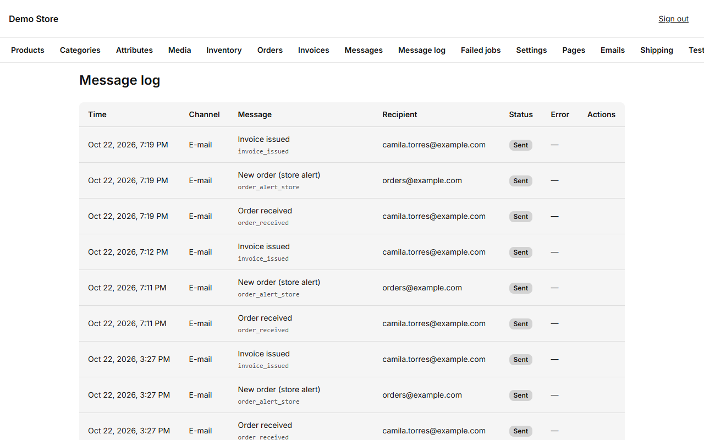
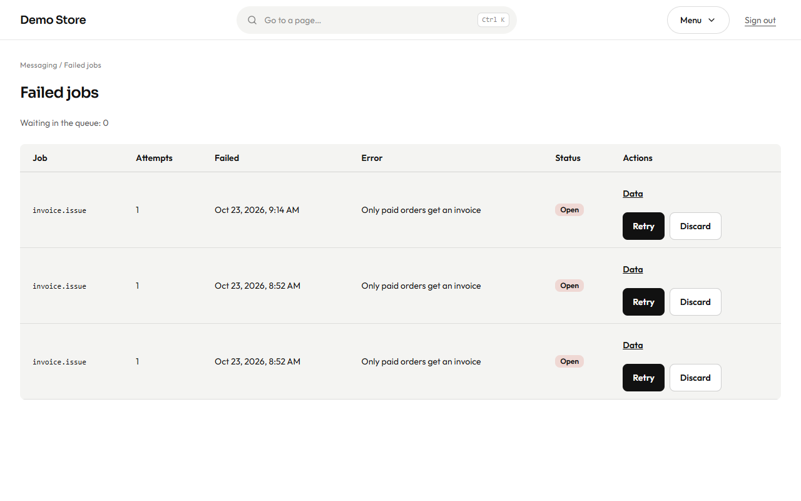

## Messages from the contact form

Everything a visitor writes in the shop's contact form arrives under **Messages**, newest first. The dashboard shows how many are
unread.

- **Reply by e-mail** opens your email program addressed to the person.
- **Mark as read** removes the unread marker so the dashboard count stays honest.

The visitor automatically receives a short "we got your message" reply, and the store's own address receives an alert, both in
the language of the page they wrote from.

## The message log

**Message log** lists every email (and WhatsApp message) the store tried to send: when, through which channel, which message,
to whom, and whether it is *Queued*, *Sent*, *Delivered*, *Read*, *Failed* or *Skipped*.

A message can be **skipped** on purpose, for example a WhatsApp message to someone who did not opt in. The reason is shown. A
message that **failed** has a **Retry** button once you have fixed the cause (usually a wrong sender address or an expired key).

:::tip
When a customer says "I never got my email", search the log for their address. It shows whether the store sent it, and when.
:::

## Failed jobs

Some work happens in the background: sending an email, building an invoice PDF, checking stock alerts. If a task keeps failing
after several automatic retries, it is parked under **Failed jobs** instead of being lost. **Owners** can **Retry** a job once the
problem is fixed or **Discard** it when it no longer matters.

The dashboard card **Failed jobs** should read **0**. A number there means something needs a look.
