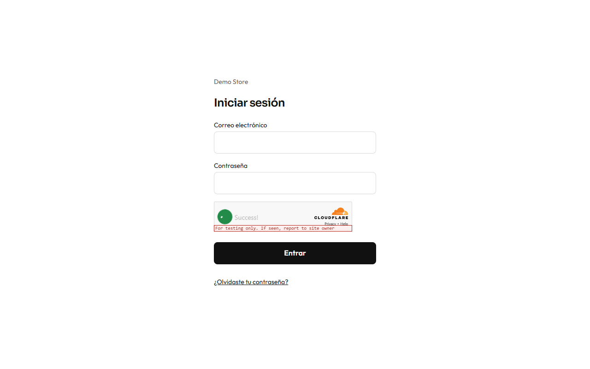
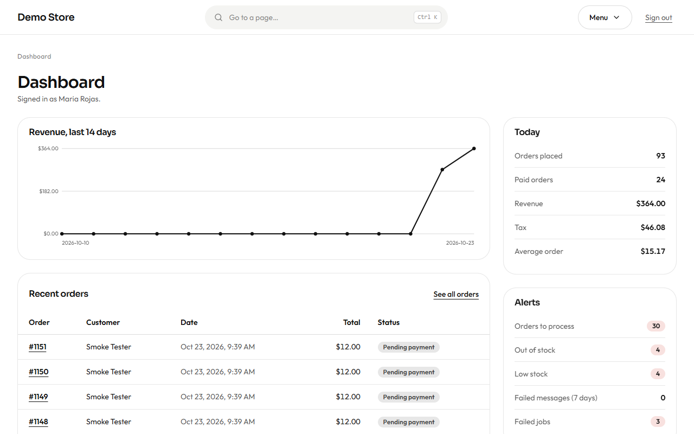
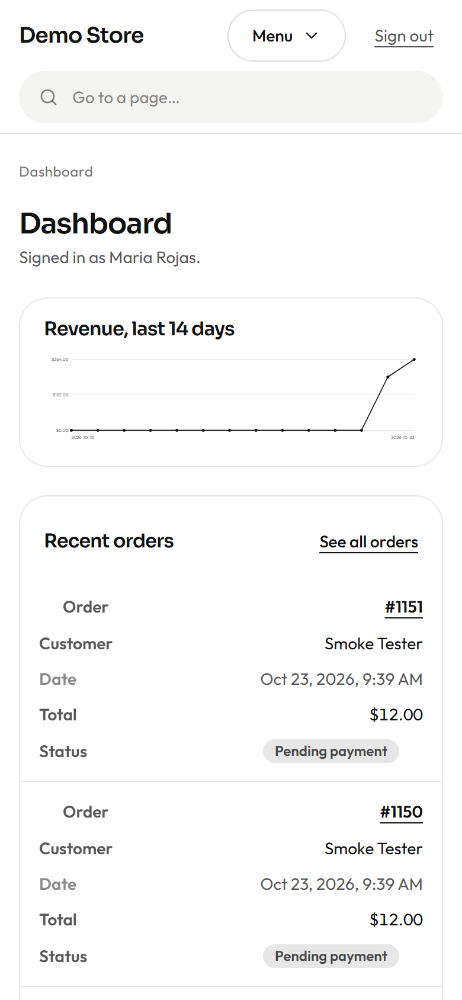

The admin is where the people who run the shop work. It lives at `/admin` on your store's address (for example
`https://your-shop.com/admin`) and works on a phone or a laptop.

## Signing in

Enter your email and password. If you forgot the password, choose **Forgot password** and the store emails you a link that is
valid for 30 minutes. There is a limit on sign-in attempts and a bot check, so guessing passwords does not work.

:::note[The very first time]
When a store is launched, the person who deploys it opens `/admin/setup` once, enters the setup code they were given, and creates
the first **owner** account. That page stops working as soon as an owner exists. See [Launching a store](/en/clients/launch/).
:::

## The dashboard

The first screen shows how the shop is doing right now.

The screen has two columns. On the left:

- A chart of revenue for the **last 14 days**.
- **Recent orders:** the six newest, with customer, date, total and status. Click the number to open an order, or **See all orders**.
- **Top products** of the last 30 days.

On the right, which stays in view while you scroll the left:

- **Today:** orders placed, paid orders, revenue, tax and the average order.
- **Alerts:** orders to process, out of stock, low stock, failed messages and failed jobs. Each row leads to the list behind its
  number. They should be **0**, except the orders to process; see
  [Messages and notifications](/en/admin/messages-and-notifications/).
- **Other periods:** revenue and paid orders for the last 7 and 30 days.

On a phone the two columns stack into one.

## The menu and the search

The bar at the top has the store name, a **search box**, the **Menu** button and **Sign out**.

- **Menu** opens every page of the admin in five sections: **Catalog** (Products, Categories, Attributes, Media, Inventory),
  **Sales** (Orders, Invoices, Shipping, Reports), **Content** (Pages, Testimonials, Emails), **Messaging** (WhatsApp, Message log,
  Failed jobs) and **Store** (Settings, Users). This guide follows nearly the same order.
- The **search box** ("Go to a page…") filters those pages as you type; **Enter** opens the first one. On a laptop, **Ctrl K**
  (or **⌘ K**) puts the cursor in the search box from any page, and **Esc** closes the menu.
- Above each page title a small line shows the section and the page ("Sales / Orders"), so you always know where you are.

## Roles: who can do what

There are two roles.

| Can…                                                        | Editor | Owner |
| ----------------------------------------------------------- | :----: | :---: |
| Manage products, categories, attributes and media           |   ✔    |   ✔   |
| Process orders and change their status                      |   ✔    |   ✔   |
| Adjust and import stock                                     |   ✔    |   ✔   |
| Edit pages, testimonials and email wording                  |   ✔    |   ✔   |
| Change **settings** (tax, checkout, payment, WhatsApp…)     |        |   ✔   |
| Void an invoice                                             |        |   ✔   |
| Invite and manage **users**                                 |        |   ✔   |
| Retry or discard failed jobs, connect **WhatsApp**          |        |   ✔   |

Give people the Editor role for daily work and keep the Owner role for the people who run the business. Permissions are checked
on the server, so a hidden button is never the only protection.
