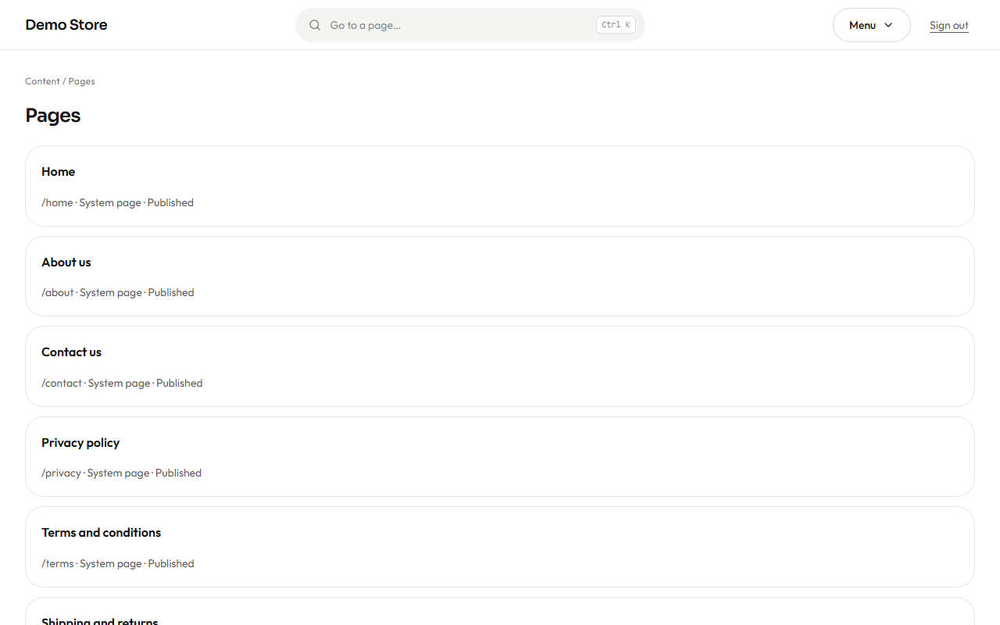
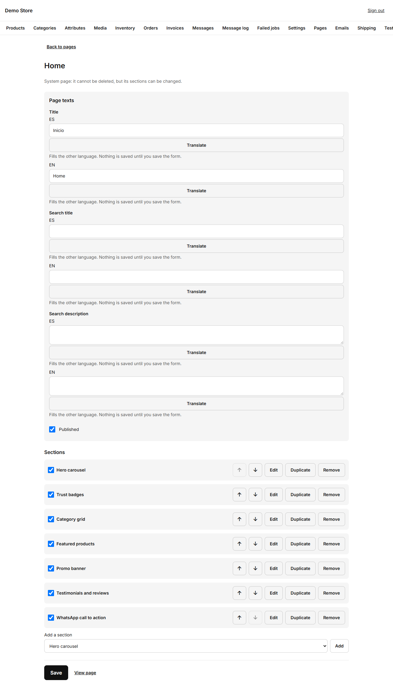
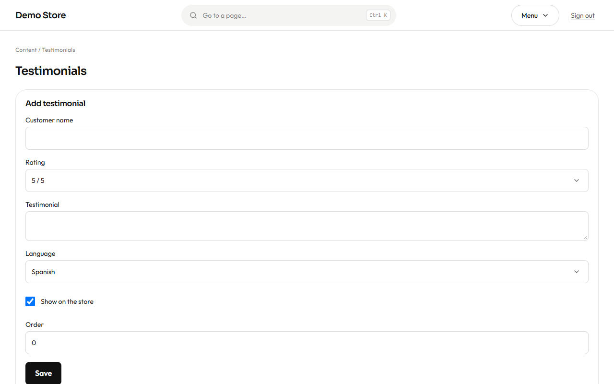

## Pages

**Pages** lists every page of the shop that is made of sections.

- **System pages** exist in every store and cannot be deleted: **Home, About, Contact, Privacy, Terms** and **Shipping and
  returns**. You can change what they say and how they are laid out.
- **Custom pages** are yours: a size guide, a story, a wholesale page. Create one with **New page**, give it a name in both
  languages and it gets an address such as `/en/p/size-guide`.

## The page builder

Open a page to edit it.

**Page texts** hold the title and the text Google shows (search title and description), each in Spanish and English, and a
**Published** switch.

**Sections** are the building blocks, shown from top to bottom as the shopper sees them. For each one you can switch it on or
off (the tick), move it up or down with the arrows, **Edit** its content, **Duplicate** it or **Remove** it. Add a new one from the
list at the bottom and press **Add**.

| Section                       | What it shows                                                             |
| ----------------------------- | ------------------------------------------------------------------------- |
| **Hero carousel**             | Large slides with a background picture, a title, a subtitle and a button.  |
| **Featured products**         | A row or grid of products you choose, or the ones marked *Featured*.       |
| **Category grid**             | Tiles that lead to categories.                                            |
| **Trust badges**              | Short reasons to buy (secure payment, fast shipping, returns).             |
| **Testimonials and reviews**  | The testimonials you wrote, and optionally Google reviews.                |
| **WhatsApp call to action**   | A prominent button that opens a chat.                                      |
| **Promo banner**              | A highlighted notice for an offer or a campaign.                           |
| **Image gallery**             | A set of pictures.                                                         |
| **FAQ**                       | Questions and answers that open and close.                                 |
| **Rich text**                 | Free text with headings, lists and links (Markdown).                       |

Press **Save**, then **View page** to see it. The home page is a page like any other, so rearranging it is a matter of moving
sections.

## Testimonials

**Testimonials** are short quotes from happy customers. Add the name, a rating from 1 to 5, the text and the language, choose the
order, and switch it on or off.

They appear in the *Testimonials and reviews* section of any page that includes it. Only show real opinions: it keeps your
customers' trust, and in many countries it is a legal requirement.
