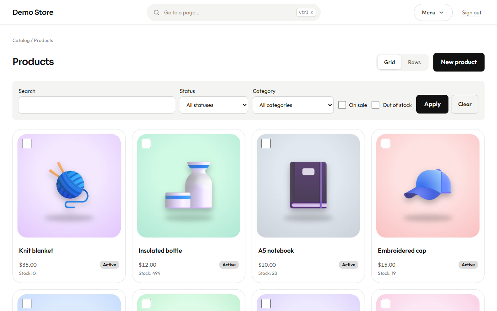
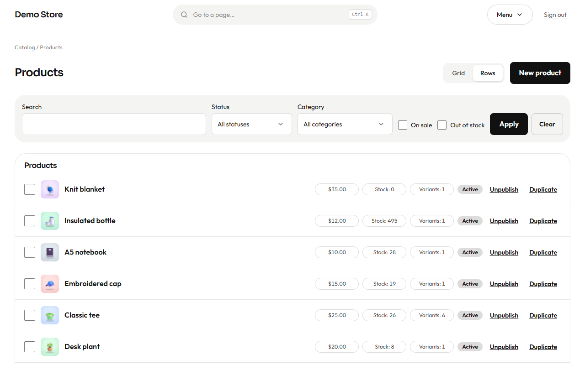
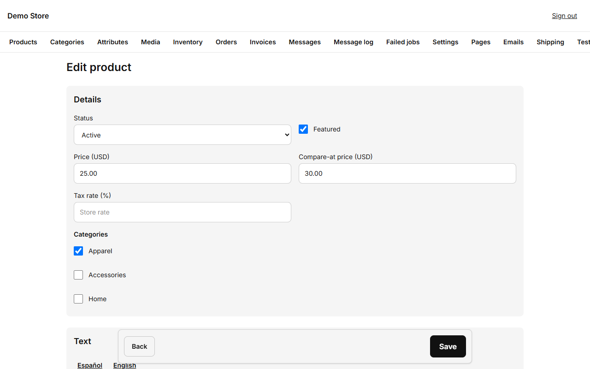
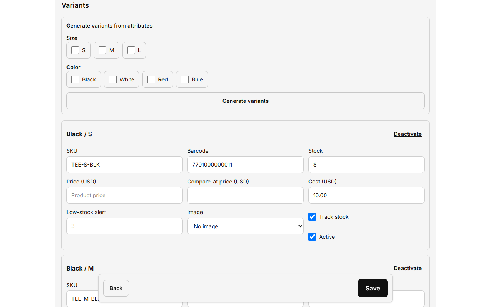

## The product list

Find products with the search box or the **Status**, **Category**, **On sale** and **Out of stock** filters. At the top right you
choose how to see them:

- **Grid:** one card per product with its picture, name, price, status and stock. It is the view for recognising a product at a
  glance. A product without a picture shows its initial.
- **Rows:** one row per product with price, stock and the number of variants, and two quick actions: **Unpublish / Publish** (hide a
  product from the shop without deleting it) and **Duplicate** (start a new product from an existing one, handy for similar items).

The view is kept in the address (`?view=rows` for rows; the grid is the default), so you can bookmark or share it.

### Changing several products at once

Tick the box of each product, in either view. A bar appears at the bottom with **"N selected"**, **Unpublish** and **Publish**: the
change applies to everything ticked in one request (up to 100). Products that no longer exist are ignored.

Press **New product** to add one.

## Editing a product

**Details**

- **Status:** *Draft* (not visible), *Active* (for sale) or *Archived* (kept but hidden).
- **Featured:** shows the product in featured blocks on the home page.
- **Price** and **Compare-at price:** the compare-at price is the old price that is crossed out when you run a sale. Money is
  entered in the store currency, for example `25.00`.
- **Tax rate:** leave empty to use the store's rate, or set a different one (for example 0% for a tax-free item).
- **Categories:** tick one or more.

**Text** has a tab for each language. Write the name, short description and a longer description in Markdown (use `**bold**`,
lists and links). The **slug** is the web address of the product in that language; leave it empty and it is made from the name.
**SEO title** and **SEO description** are what Google shows; if you leave them empty the store writes sensible ones.

**Preview:** on the right (below, on a phone) the store draws the product's card from what you type: picture, name, price, sale
badge and category. It changes as you type, before you save.

**Images:** add pictures from the media library, drag them with the arrows to reorder them. The first one is the product's main
picture and appears in listings and when a link is shared.

## Options (variants)

Many products come in sizes or colours. Each combination is a **variant** with its own SKU, barcode, stock and, if needed, its
own price.

1. Under **Generate variants from attributes**, tick the values you sell (for example sizes S, M, L and colours Black, White).
2. Press **Generate variants**. The store creates every combination.
3. Fill in each variant: **SKU** (your code), **Barcode**, **Stock**, **Cost** (what it costs you, used in inventory value and
   reports), an optional **Price** if this option costs more, a **Low-stock alert** level, and an optional picture.
4. **Track stock** turns stock counting on or off (turn it off for services or made-to-order items). **Deactivate** hides a
   variant without losing its history.

A product with no sizes or colours has a single variant; the form still shows it so you can set its SKU and stock.

Press **Save**. The **Note for stock changes** field at the bottom is saved with any stock change you made, so the
[inventory history](/en/admin/inventory/) shows why.

:::tip
Saving a product refreshes the shop pages that show it. Open the product page in a private window to see exactly what a shopper
sees.
:::

Categories, attributes (sizes, colours) and pictures are set up in [Catalog setup](/en/admin/catalog-setup/).
