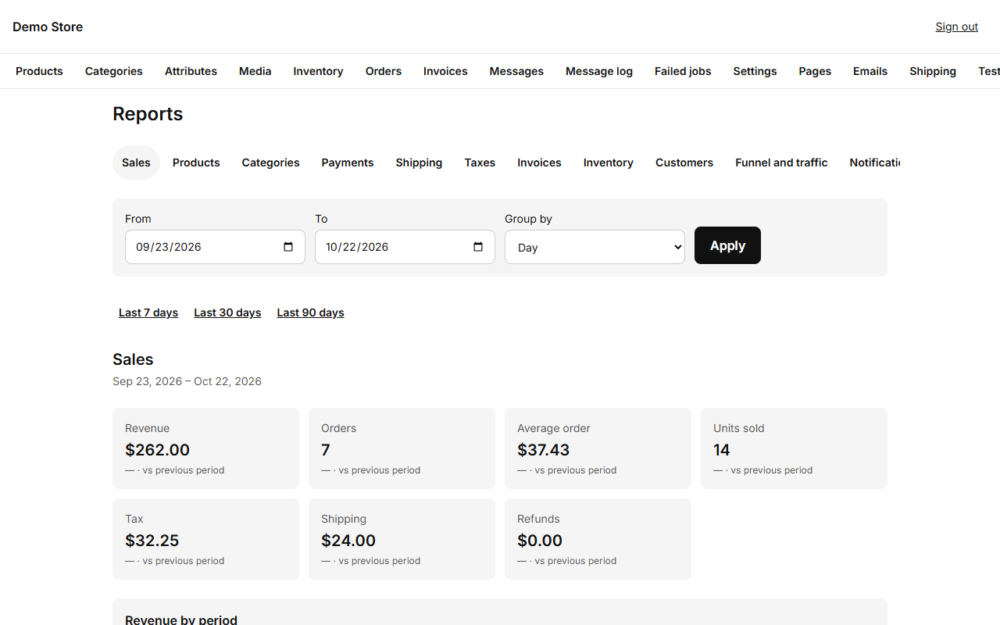

**Reports** turns your orders, stock and visitors into numbers you can act on.

## Choosing a report

The tabs across the top are the reports:

| Report                | Answers                                                              |
| --------------------- | -------------------------------------------------------------------- |
| **Sales**             | Revenue, orders, average order, units, tax, shipping and refunds.     |
| **Products**          | Best sellers and slow movers.                                        |
| **Categories**        | Which parts of the catalog sell.                                     |
| **Payments**          | How customers pay, and how much each method brings.                  |
| **Shipping**          | Shipping income and the methods used.                                |
| **Taxes**             | Tax collected by rate, for your tax return.                          |
| **Invoices**          | Invoices issued, voided and their totals.                            |
| **Inventory**         | Stock value, low and out-of-stock items.                             |
| **Customers**         | New and returning customers, and who buys most.                      |
| **Funnel and traffic**| Visitors, product views, carts and purchases, and where they came from. |
| **Notifications**     | Emails and messages sent, failed or skipped.                         |

## Choosing the period

1. **Set the range.** Set **From** and **To**, or press **Last 7 days**, **Last 30 days** or **Last 90 days**.
2. **Group if you need to.** For sales you can group the chart by day, week or month. Each number shows how it compares with the period before it.
3. **Download the CSV.** **Download CSV** exports the report table.

## Weekly summary

The store can email a short summary every week. Turn it on, and choose the weekday and hour, in
[Settings](/en/admin/settings/) under **Reports**.

:::tip[A simple weekly habit]
Every Monday: open **Sales** for the last 7 days, **Products** to see what sold, and **Inventory** for what to reorder. Ten minutes
is enough to catch problems early.
:::
