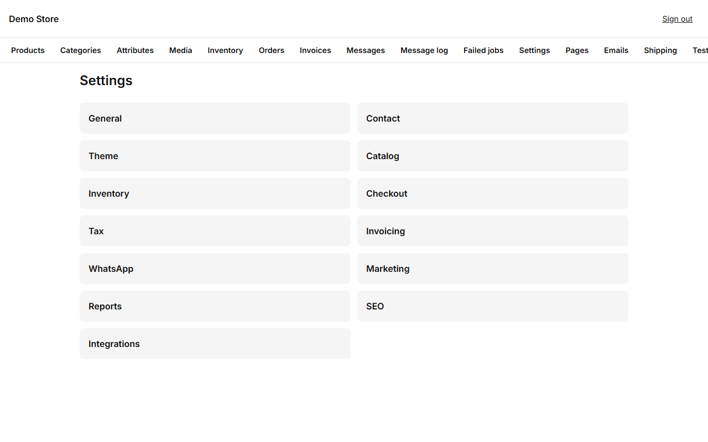
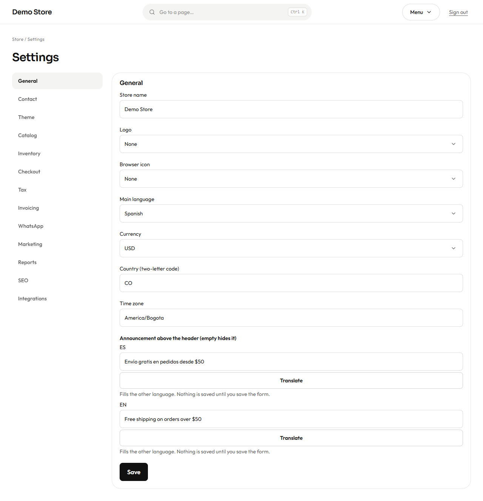
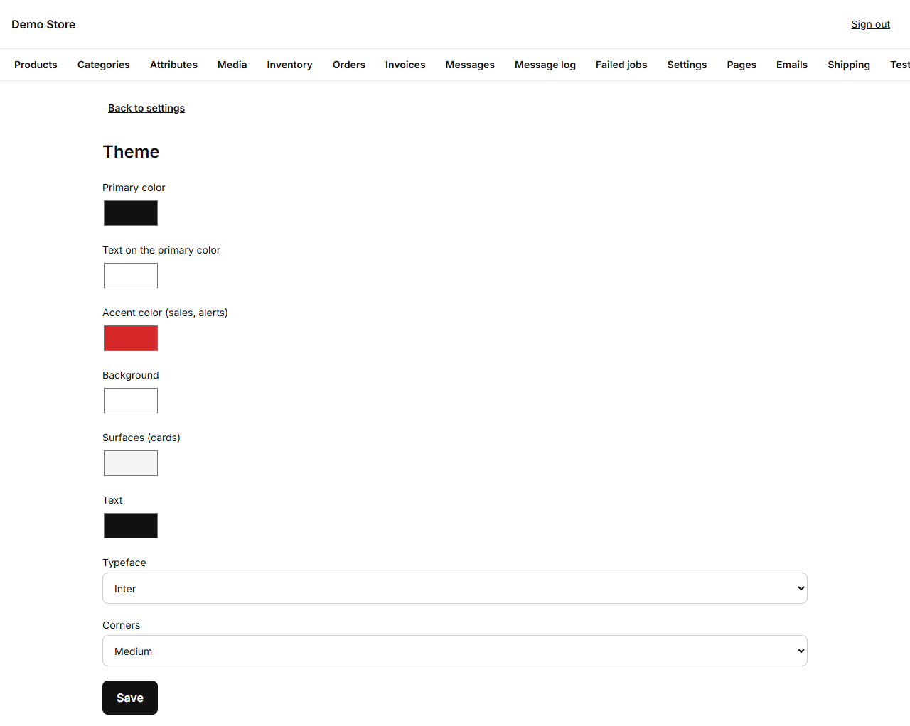
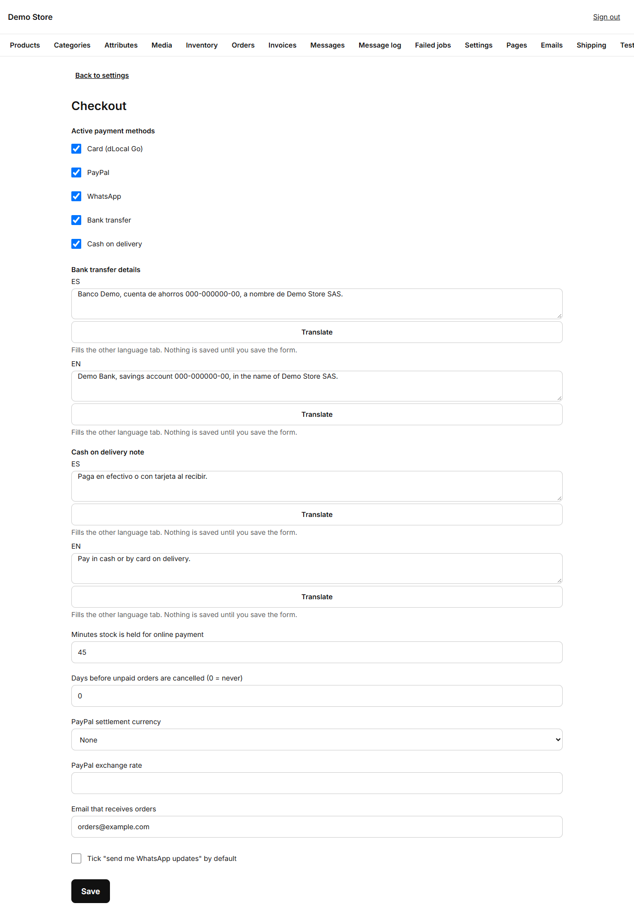

Settings are changed by **owners**. Each group saves on its own, and the change is live in the shop straight away.

| Group            | What it controls                                                                                                                         |
| ---------------- | ---------------------------------------------------------------------------------------------------------------------------------------- |
| **General**      | Store name, logo, browser icon, main language, currency, country, time zone.                                                             |
| **Contact**      | Public email, phone and address, the WhatsApp number and its default message, the floating WhatsApp button, the map.                      |
| **Theme**        | Colours, typeface and how rounded the corners are.                                                                                       |
| **Catalog**      | Products per page, how many days a product counts as *New*, the default sort, where sold-out products appear, when to show stock counts. |
| **Inventory**    | The default low-stock level, whether low-stock alerts are sent (and by which channel), and back-in-stock notices.                         |
| **Checkout**     | Payment methods, bank and cash-on-delivery texts, how long stock is held, automatic cancellation of unpaid orders, PayPal currency.       |
| **Tax**          | The tax name and rate (19% by default), whether your prices already include it, whether shipping is taxed, and the tax breakdown.         |
| **Invoicing**    | Whether invoices are issued, the series letters (for example `FV`), and your company name, tax ID, regime, address and footer note.       |
| **WhatsApp**     | Whether WhatsApp messages are on, the number that receives store alerts, and the default country code.                                    |
| **Marketing**    | The Meta Pixel, the Conversions API, the product feed for catalogs, and the cookie banner mode.                                           |
| **Reports**      | The weekly summary email (on or off, weekday, hour) and how many days without sales make a product a "slow mover".                        |
| **SEO**          | The page title pattern (`%s` is replaced by the page name), the default description and the sharing image.                                |
| **Integrations** | Google reviews (place) and the Cloudflare visitor-statistics token.                                                                       |

## The first settings to set

1. **General:** store name, currency and time zone.

   

2. **Tax** and **Invoicing:** the rate and your company details, and make sure invoicing is switched on, so the first invoice is
   right.
3. **Contact:** the email and WhatsApp customers will use.
4. **Theme:** your brand colours.

   

   Pick the primary colour for buttons, the accent for sale badges, and one of the typefaces (Inter, Manrope or Playfair Display).
   The store checks that colours are valid, so a typing slip cannot break the layout.

5. **Checkout:** choose the payment methods you accept and write your bank details and cash-on-delivery note in both languages.

   

   - **Minutes stock is held for online payment:** how long an unpaid card or PayPal order keeps its stock reserved (15 to 1,440).
   - **Days before unpaid orders are cancelled:** automatic clean-up for bank transfers nobody paid (`0` = never).
   - **Email that receives orders:** where the "new order" alert goes.

:::note
A payment method only works if its keys are configured on the server (that is part of [launching the store](/en/clients/launch/)).
Ticking it here without the keys shows an error to the shopper, so turn a method on only when it has been tested.
:::
