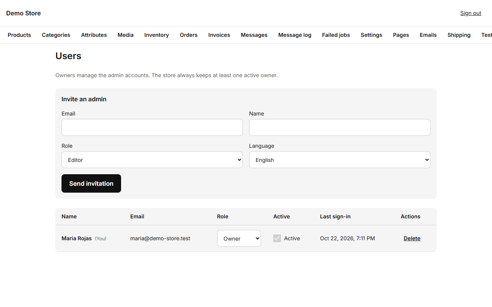
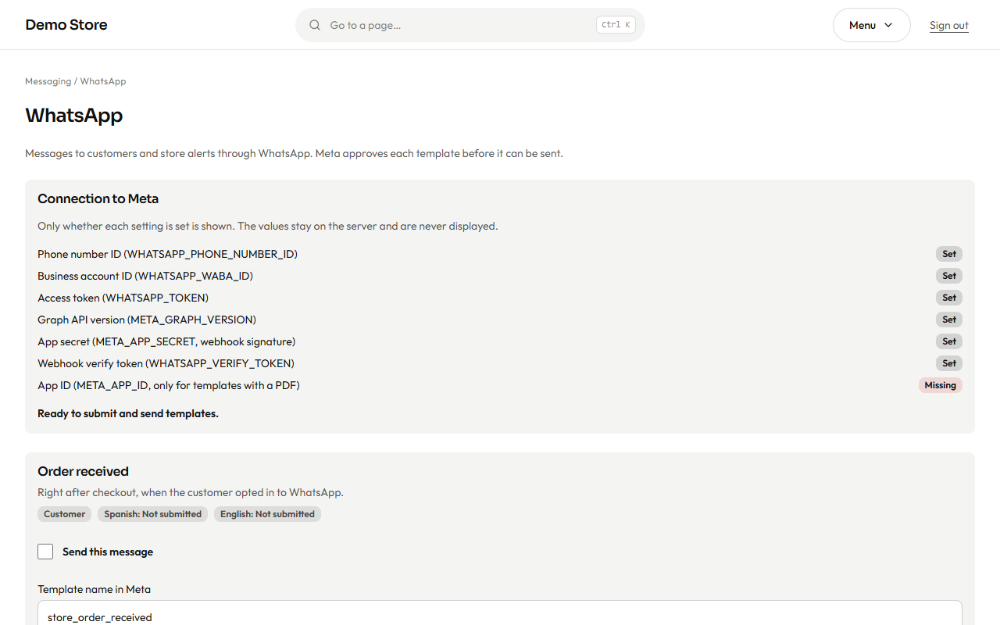

## Users

**Users** (owners only) manages who can sign in.

To add someone, fill in their **email**, **name**, **role** (Editor or Owner) and **language**, and press **Send invitation**. They
receive an email with a link to choose their password. Until they accept, they cannot sign in.

In the list you can change a person's **role**, switch **Active** off to stop them signing in without deleting their history, or
**Delete** them. Two rules protect you: the store always keeps **at least one active owner**, and nobody can change their own
role or switch off their own account.

:::caution[When someone leaves]
Switch their account to inactive the same day. Their past work stays in the history, but they can no longer sign in.
:::

## WhatsApp

WhatsApp can carry the same messages as email (order received, shipped, invoice…) and your store alerts. It uses the official
WhatsApp Business platform from Meta, which has two consequences:

- Every message is a **template that Meta approves** before it can be sent.
- A customer receives WhatsApp messages only if they **agreed** at checkout.

The **WhatsApp** screen (owners only) is where this is managed.

1. **Connection to Meta** lists the seven values the connection needs, each marked **Set** or **Missing**. The values themselves
   are never shown; they are stored securely on the server when the store is launched. See the
   [WhatsApp setup guide](/en/clients/launch/#whatsapp-optional) for how to get them.
2. Below, each message has a card: the template name, the status in Spanish and English (*Not submitted*, *Pending*,
   *Approved*…), a **Send this message** switch, and buttons to **Submit** the template to Meta, **Sync** its status, and **Send a
   test**.
3. A message is sent only when WhatsApp is on in [Settings](/en/admin/settings/), the connection is complete, the message is switched
   on, and Meta has approved the template in the customer's language. Anything else is recorded as **Skipped**, with the reason,
   in the [message log](/en/admin/messages-and-notifications/).

The shop also has an optional floating WhatsApp button and a WhatsApp payment option; both work without the Meta connection,
because they simply open a chat.
