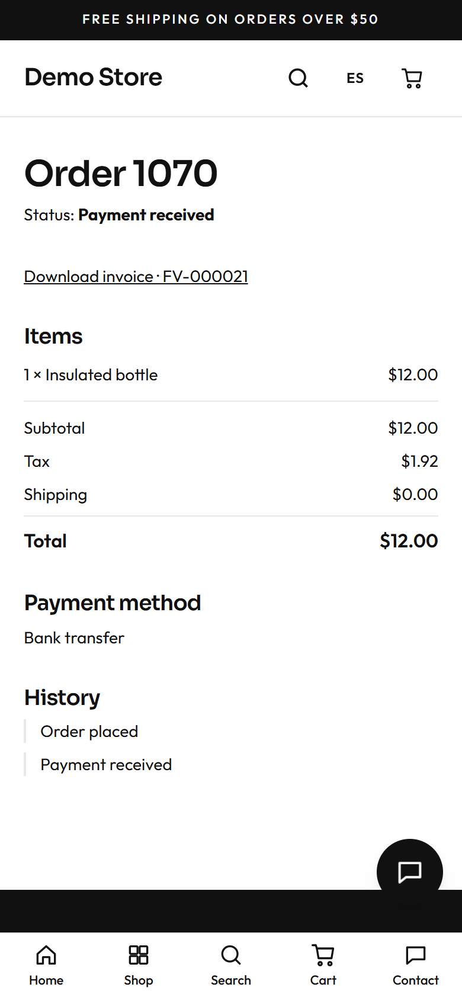
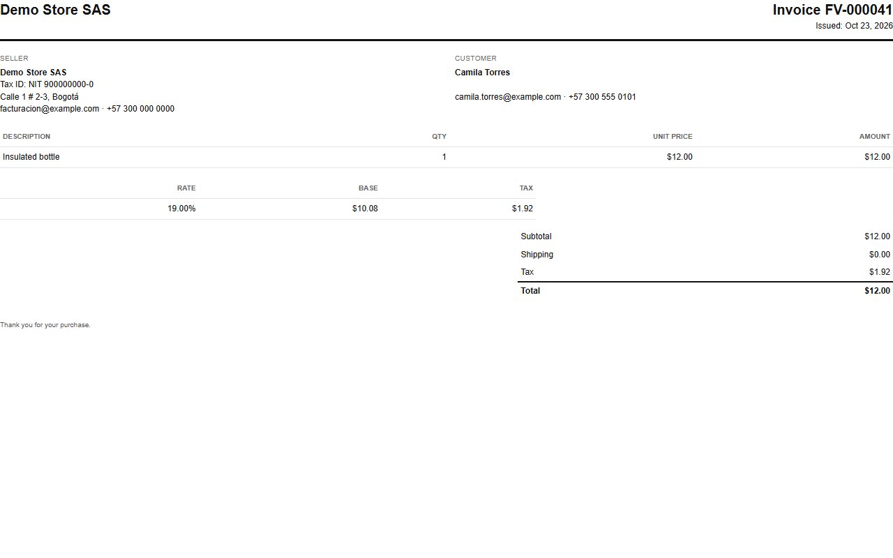
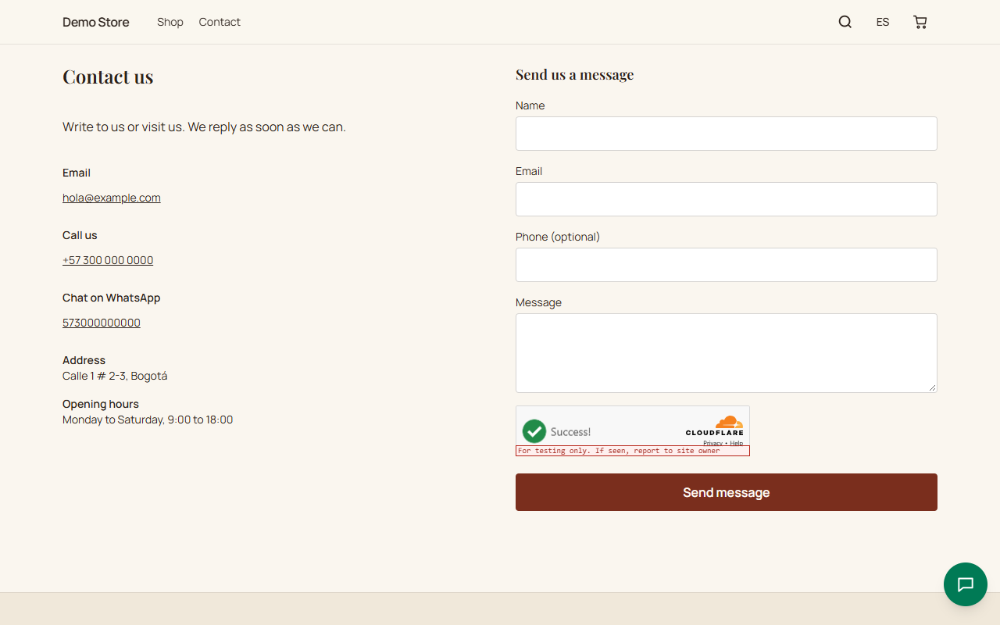

## The order page

Right after placing an order the shopper lands on their **order page**: status, items, totals, payment method, and a history of
what happened. The address contains a private key, so only people who have the link (the shopper, in their email) can open it.
For bank transfer it shows the bank details; for cash on delivery, the owner's note.

## Emails

The shopper receives an email when the order is placed and again when it is paid, shipped or delivered. The store also receives
an email alert for every new order. If WhatsApp is switched on and the shopper agreed, the same messages go to WhatsApp. The
owner can edit the wording in the [email templates](/en/admin/emails-and-shipping/).

## Invoices

When an order is paid, the store issues a numbered invoice (for example `FV-000005`) with the seller's and the customer's details,
each line, the tax breakdown and the total. The shopper gets it by email as a PDF and can open it from the order page.

## Contact

The **Contact** page has no form: it shows the ways to reach the store as cards. **WhatsApp** comes first and opens a chat with a
message already written; then **email**, **phone** (tapping it calls), **address** and **opening hours**. Below come the social
links, the map (loaded only if the visitor asks for it) and the Google reviews. All of it comes from
[Settings](/en/admin/settings/), under Contact.

