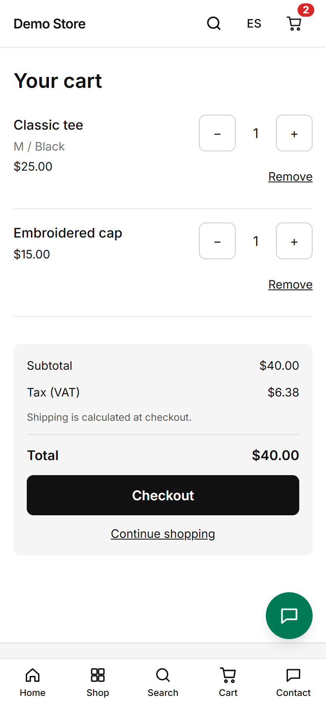
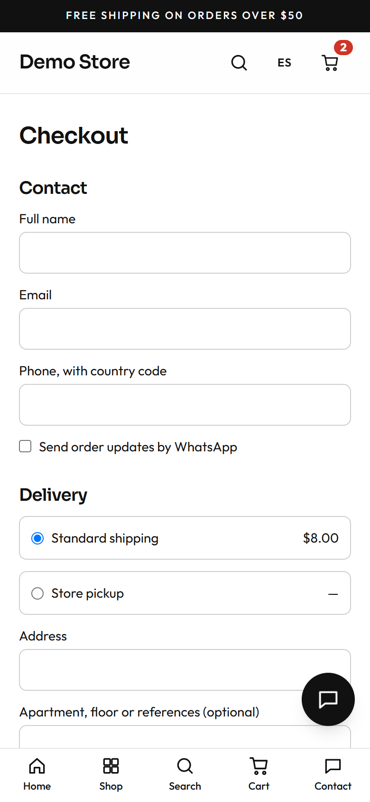
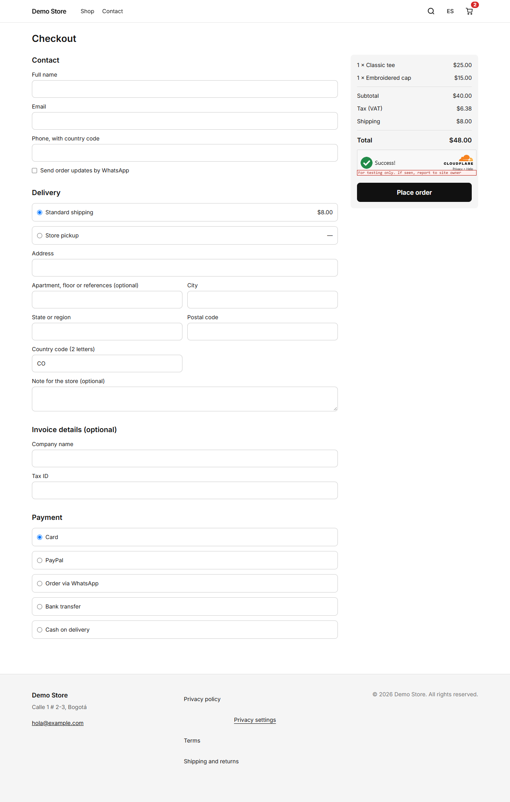

## The cart

The cart lives in the shopper's browser, so it survives closing the tab. The server **re-prices every line** before showing a
total, so a price change made in the admin is reflected, and nobody can alter a price by editing their browser. Shoppers can
change quantities (up to 20 per line) or remove items. Tax is shown; shipping is worked out at checkout, because it depends on
the delivery choice.

## Checkout

Checkout is one page.

1. **Contact:** name, email and a phone number with country code. A box asks whether the shopper wants order updates by WhatsApp
   (the owner can tick it by default in the [checkout settings](/en/admin/settings/)).
2. **Delivery:** the shipping methods the owner has set up, each with its price. Choosing **Store pickup** hides the address.
3. **Address:** street, apartment, city, region, postal code and country.
4. **Invoice details (optional):** company name and tax ID, for shoppers who need a business invoice.
5. **Payment:** the methods the owner has switched on.
6. **Summary and Place order.** The total is checked again on the server when the order is placed.

A bot check (Cloudflare Turnstile) runs in the background, so shoppers are not asked to solve puzzles.

## Payment methods

| Method               | What the shopper sees                                                                     | When the order becomes **paid**                     |
| -------------------- | ----------------------------------------------------------------------------------------- | --------------------------------------------------- |
| **Card** (dLocal Go) | Redirected to the secure dLocal Go page to enter card details, then back to the store.     | Automatically, when dLocal Go confirms.             |
| **PayPal**           | Redirected to PayPal to approve, then back to the store.                                  | Automatically, when the store captures the payment. |
| **WhatsApp**         | A chat opens with the order summary so the shopper can agree payment with the store.       | By the owner, in the admin.                         |
| **Bank transfer**    | The order page shows the bank details the owner wrote.                                     | By the owner, when the transfer arrives.            |
| **Cash on delivery** | The order page shows the owner's note (for example "pay in cash or by card on delivery"). | By the owner, on delivery.                          |

Card and PayPal payments are confirmed by the payment provider calling the store directly, so an order is marked paid even if
the shopper closes the browser right after paying. The store never sees card numbers.

## What happens to stock

The store **holds the stock** for an unpaid online payment for a set time (45 minutes by default). If the shopper does not pay,
the order expires and the stock is released. If two shoppers go for the last unit, the second sees a friendly "no longer
available in that quantity" message instead of an oversold order.
