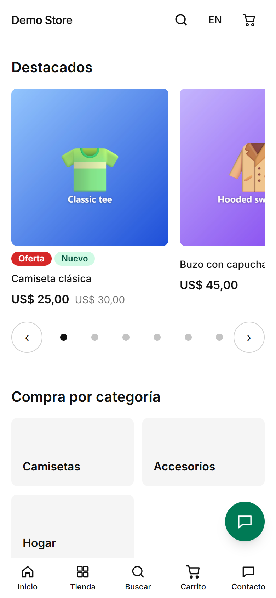

This is what a shopper goes through. Each step has its own page with screenshots.

| Step                   | What happens                                                                        | Page                                         |
| ---------------------- | ----------------------------------------------------------------------------------- | -------------------------------------------- |
| 1. Arrive              | The home page shows featured products, categories, trust badges and reviews.         | [Browsing](/en/storefront/browsing/)            |
| 2. Find a product      | Category pages, filters, sorting, and a search box that suggests as you type.        | [Browsing](/en/storefront/browsing/)            |
| 3. Choose an option    | The product page shows the price, stock, sizes and colours, and photos.              | [Browsing](/en/storefront/browsing/)            |
| 4. Cart                | Items stay in the browser, so a shopper can leave and come back.                     | [Cart and checkout](/en/storefront/cart-checkout/) |
| 5. Checkout and pay    | Contact, delivery, invoice details and one of up to five payment methods.            | [Cart and checkout](/en/storefront/cart-checkout/) |
| 6. Follow the order    | A private order page, emails, and the invoice once the order is paid.                | [After the order](/en/storefront/after-the-order/) |
| 7. Ask a question      | A contact form, and a WhatsApp button when the store uses WhatsApp.                  | [After the order](/en/storefront/after-the-order/) |

## Designed for phones

Most shoppers use a phone, so the store is designed at 360 px wide first. Buttons are at least 44 px tall, forms use the right
keyboard for each field, and the animations stop for people who ask their phone to reduce motion.

## Two languages

The header has a language switch. It keeps the shopper on the same page in the other language, including product and category
addresses, which are written in each language. Emails are sent in the language the shopper used when they ordered.
