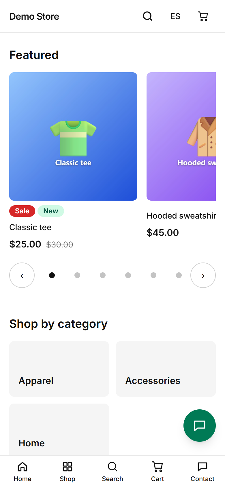

This is a ready-made online store. A shopper can browse products, pick sizes or colours, pay, and follow their order. The
people who run the shop use a separate admin to manage products, stock, orders, invoices, pages and emails. There is nothing to
install on a phone: both sides work in the browser.

## The three things it does

1. **Sells.** A catalog with variants (size, colour), a cart, checkout with five payment methods, and an order page the customer
   can come back to.
2. **Runs itself.** Stock goes down when an order is placed and comes back when an unpaid order expires. Invoices are numbered and
   issued when an order is paid. Customers get emails (and WhatsApp messages if you turn them on) at each step.
3. **Reports.** The dashboard and the reports show sales, taxes, stock, payments and where visitors drop off.

## Languages and devices

Everything the shopper sees is in **Spanish and English**, and the switch is one tap in the header. The store is designed for
phones first and scales up to a laptop. The admin works on both too; the screenshots in this guide use a laptop for the admin
and a phone for the shop, because that is how each is mostly used.

## Who should read what

| You are…                                  | Start with                                                  |
| ----------------------------------------- | ----------------------------------------------------------- |
| A shopper or someone who wants a tour     | [What shoppers see](/storefront/overview/)                  |
| A store owner or an employee in the admin | [Running the store](/admin/overview/)                       |
| A client deciding to buy or launching one | [What you get](/clients/what-you-get/)                      |
| A developer                               | The `docs/` folder of the repository (architecture, jobs…)  |

:::note
The store in the screenshots is a demo called "Demo Store" with sample products. Names, prices and customers are made up.
:::
