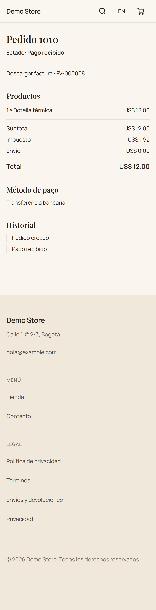
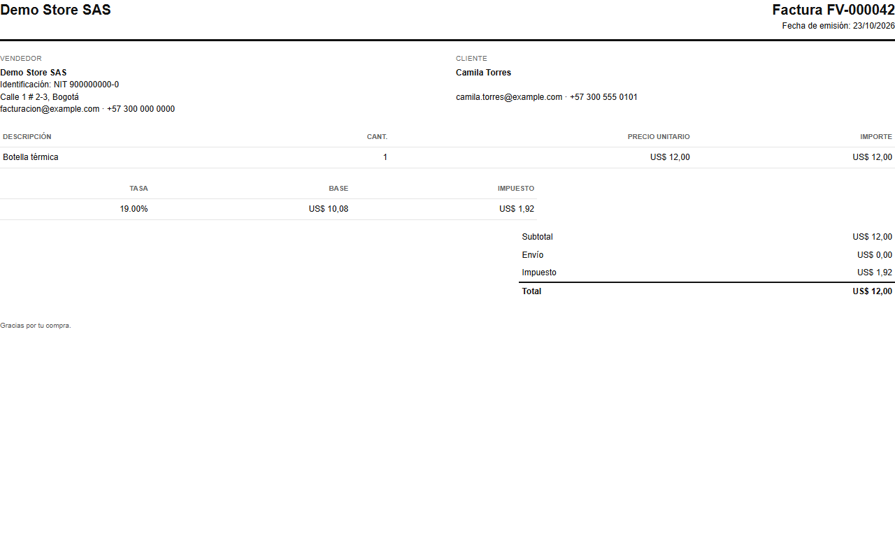
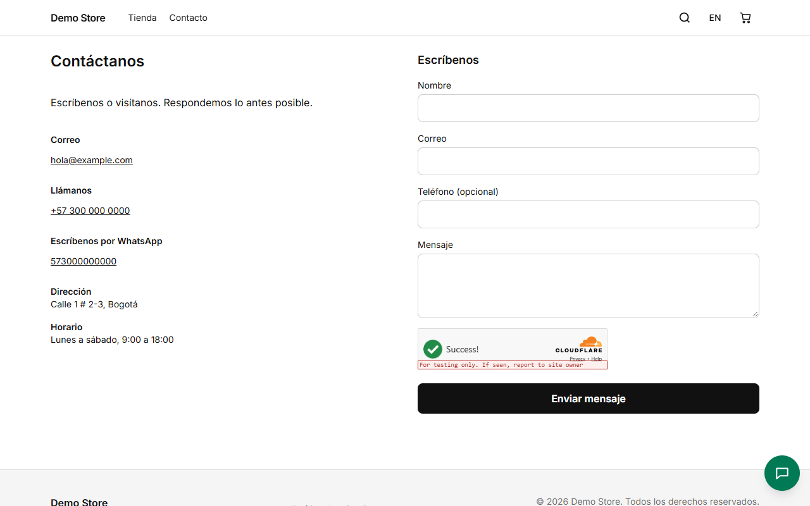

## La página del pedido

Justo después de hacer el pedido, la persona llega a su **página del pedido**: estado, productos, totales, método de pago y un
historial de lo ocurrido. La dirección lleva una clave privada, así que solo quien tiene el enlace (el cliente, en su correo)
puede abrirla. Para transferencia bancaria muestra los datos del banco; para pago contra entrega, la nota del dueño.

## Correos

El cliente recibe un correo cuando el pedido se crea y otra vez cuando se paga, se envía o se entrega. La tienda también recibe
un aviso por correo por cada pedido nuevo. Si WhatsApp está activado y el cliente aceptó, los mismos mensajes llegan por
WhatsApp. El dueño puede editar los textos en las [plantillas de correo](/admin/emails-and-shipping/).

## Facturas

Cuando un pedido se paga, la tienda emite una factura numerada (por ejemplo `FV-000005`) con los datos del vendedor y del
cliente, cada línea, el desglose de impuestos y el total. El cliente la recibe por correo en PDF y puede abrirla desde la página
del pedido.

## Contacto

La página **Contacto** no tiene formulario: muestra las formas de escribir a la tienda como tarjetas. **WhatsApp** va primero y
abre un chat con un mensaje ya escrito; después el **correo**, el **teléfono** (al tocarlo, llama), la **dirección** y el
**horario**. Más abajo van las redes sociales, el mapa (que solo se carga si la persona lo pide) y las reseñas de Google. Todo
sale de [Configuración](/admin/settings/), en Contacto.

