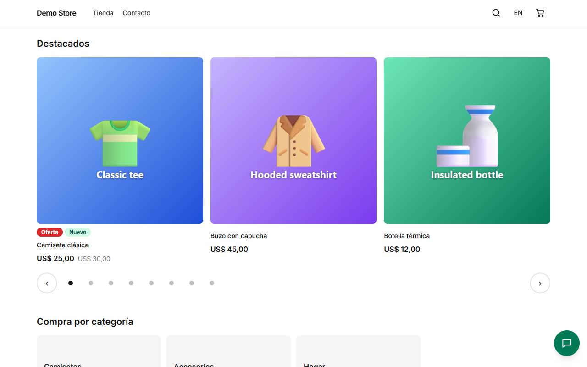
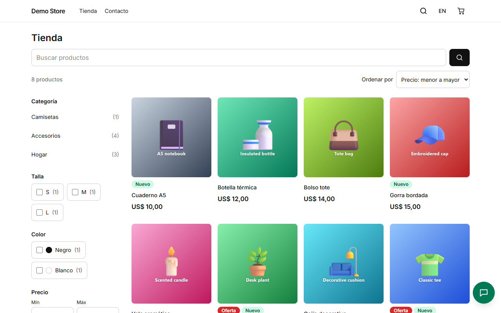
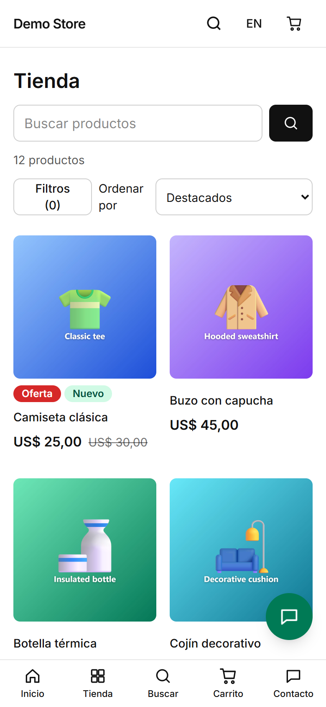
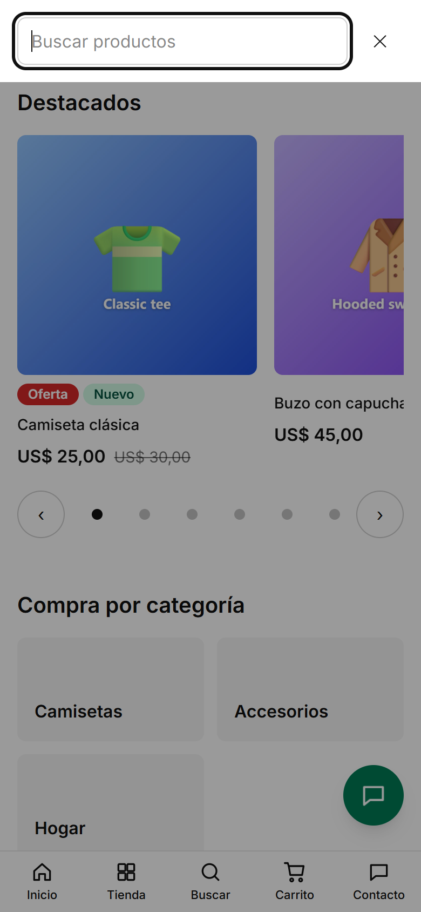
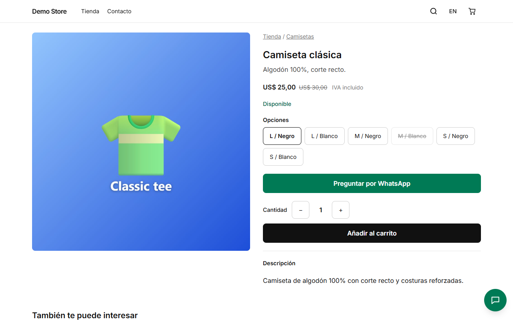
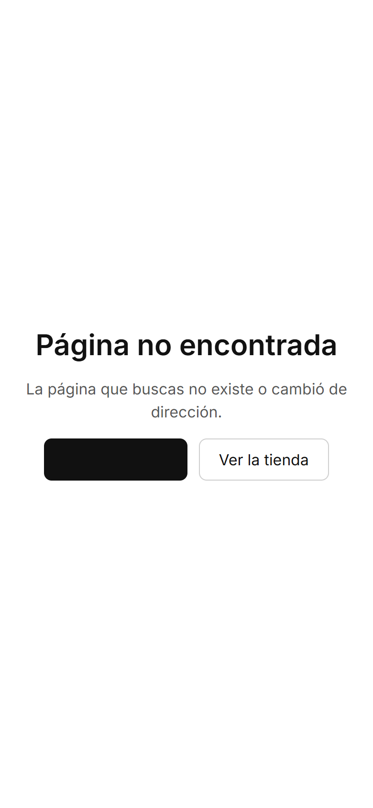

## Página de inicio

La página de inicio se compone de secciones que el dueño elige en el [editor de páginas](/admin/pages-and-content/): un carrusel
principal, productos destacados, una cuadrícula de categorías, ventajas (envío, pago seguro…), opiniones de clientes y una
llamada a la acción por WhatsApp. Los productos pueden mostrarse como carrusel o como cuadrícula.

## La tienda y sus filtros

La página **Tienda** lista todos los productos activos. Se puede acotar por categoría, por cualquier atributo que sirva de filtro
(talla, color…), por rango de precio y por «en oferta» o «disponible», y ordenar por destacados, precio, novedad o más vendidos.
Cada elección forma parte de la dirección, así que una vista filtrada se puede compartir o guardar, y el botón Atrás funciona como se
espera.

En el celular los filtros se abren con un botón sobre la lista y muestran un contador en vivo de resultados, de modo que se ve lo
que dará «Aplicar» antes de pulsarlo.

:::tip[Para los buscadores]
Las páginas de categoría y la tienda sin filtros se indexan. Las vistas filtradas u ordenadas se marcan `noindex` para que Google
no se llene de casi-duplicados. El mapa del sitio incluye solo las páginas que valen la pena.
:::

## Búsqueda

La lupa de la cabecera abre un cuadro de búsqueda que sugiere productos mientras se escribe. Al pulsar Enter se ven los
resultados completos en la tienda.

## Ficha de producto

Una ficha muestra las fotos, el precio (con el precio anterior tachado si está en oferta, e indicando si el IVA está incluido), la
disponibilidad y cada opción como un botón. Las opciones agotadas aparecen tachadas. La persona elige una cantidad y añade al
carrito. Cuando la tienda usa WhatsApp, el botón **Preguntar por WhatsApp** abre un chat con el nombre del producto ya escrito.

Si la opción elegida está agotada, la ficha ofrece **avisar por correo cuando vuelva a haber stock**.

Debajo de la descripción, **También te puede interesar** muestra productos relacionados de la misma categoría.

## Cuando algo no existe

Una dirección que no existe muestra una página amable en el idioma de quien la visita, con enlaces al inicio y a la tienda.

