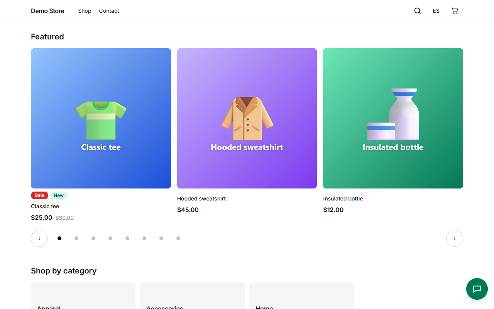
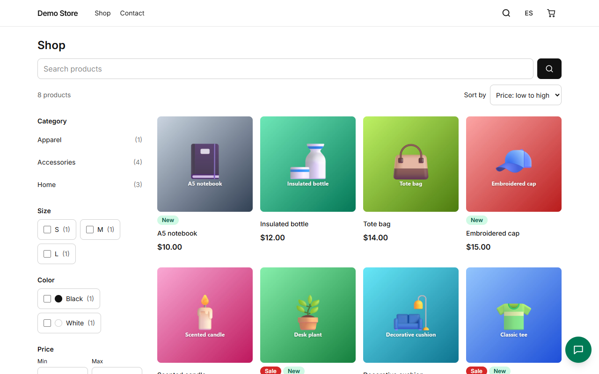
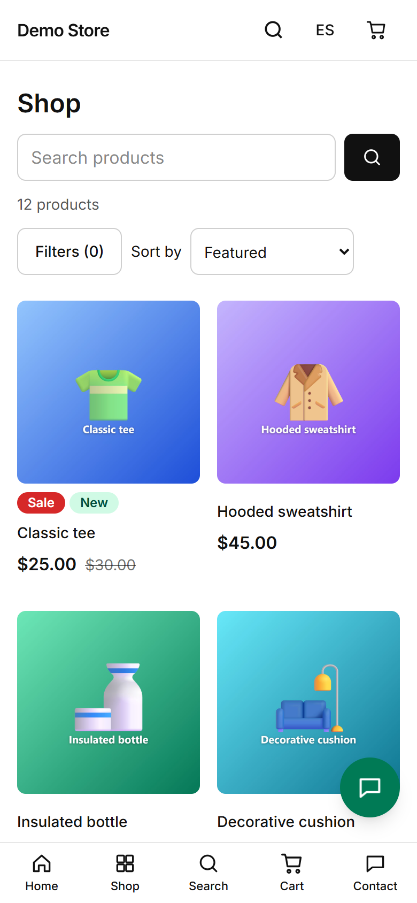
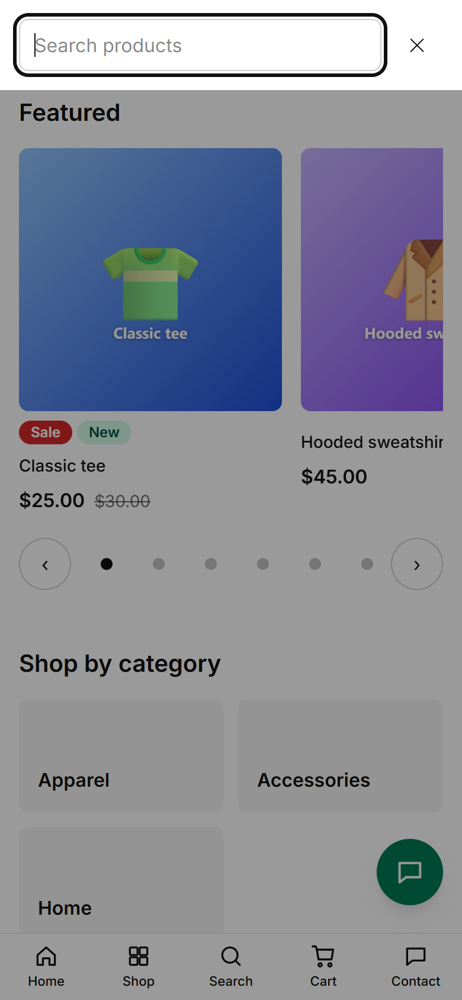
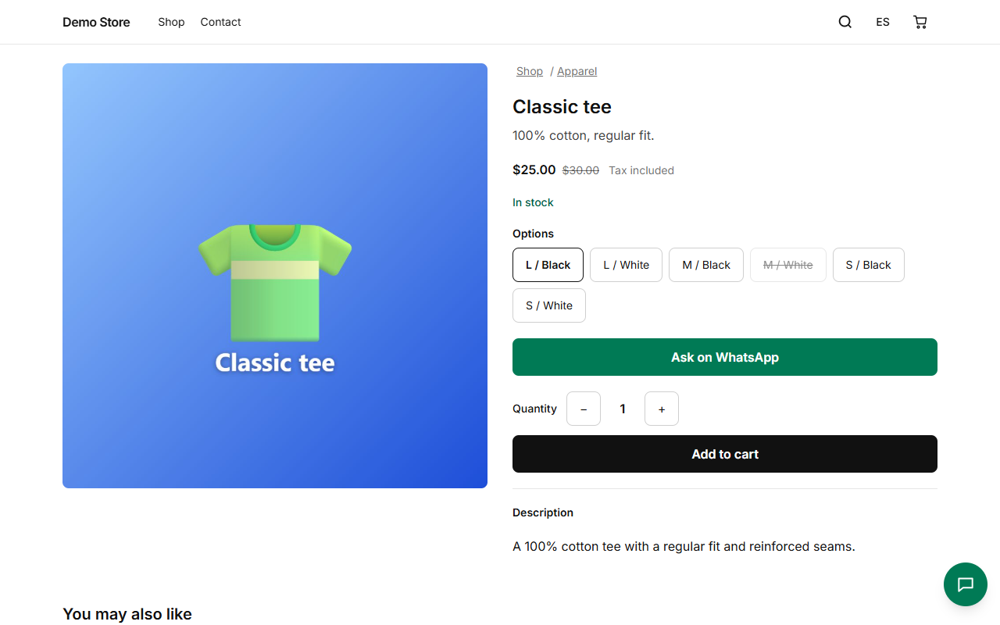
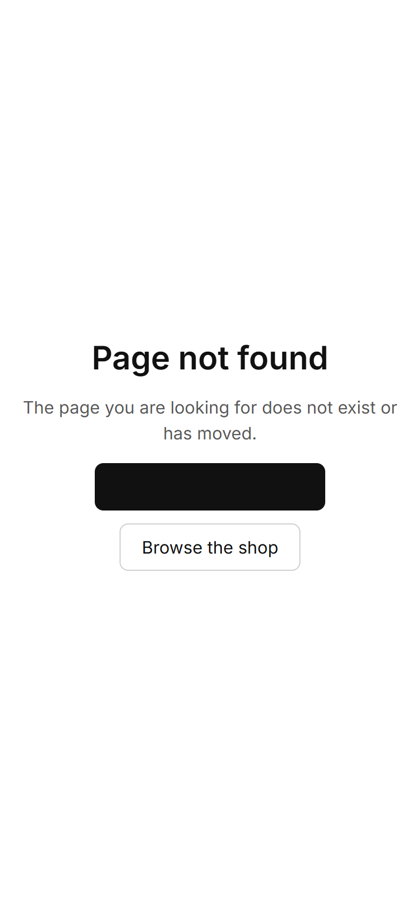

## Home page

The home page is built from sections the owner chooses in the [page builder](/admin/pages-and-content/): a hero carousel,
featured products, a grid of categories, trust badges (free shipping, secure payment…), customer reviews and a WhatsApp call to
action. Products can be shown as a carousel or a grid.

## The shop and its filters

The **Shop** page lists every active product. Shoppers can narrow the list by category, by any filterable attribute (size,
colour…), by price range, and by "on sale" or "in stock", and sort by relevance, price, newest or best selling. Each choice is part
of the address, so a filtered view can be shared or bookmarked, and the Back button works as expected.

On a phone the filters open from a button above the list and show a live count of results, so the shopper sees what "Apply"
will give before pressing it.

:::tip[For search engines]
Category pages and the plain shop are indexed. Filtered and sorted views are marked `noindex` so Google does not fill up with
near-duplicates. The sitemap lists only the pages worth indexing.
:::

## Search

The magnifier in the header opens a search box that suggests products as the shopper types. Pressing Enter shows the full results
in the shop.

## Product page

A product page shows photos, the price (with the old price crossed out when it is on sale, and whether tax is included), stock
status, and every option as a button. Options that are sold out are crossed out. The shopper picks a quantity and adds the item
to the cart. When the store uses WhatsApp, an **Ask on WhatsApp** button opens a chat with the product name filled in.

If the chosen option is sold out, the page offers to **notify the shopper by email when it is back in stock**.

Below the description, **You may also like** shows related products from the same category.

## When something is missing

An address that does not exist shows a friendly page in the shopper's language, with links to the home page and the shop.

