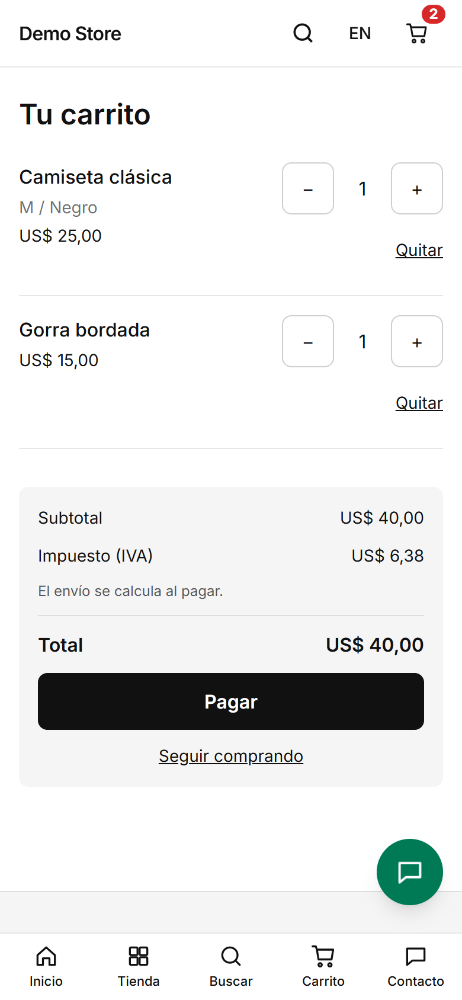
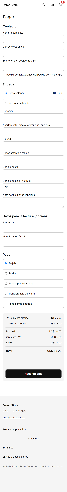
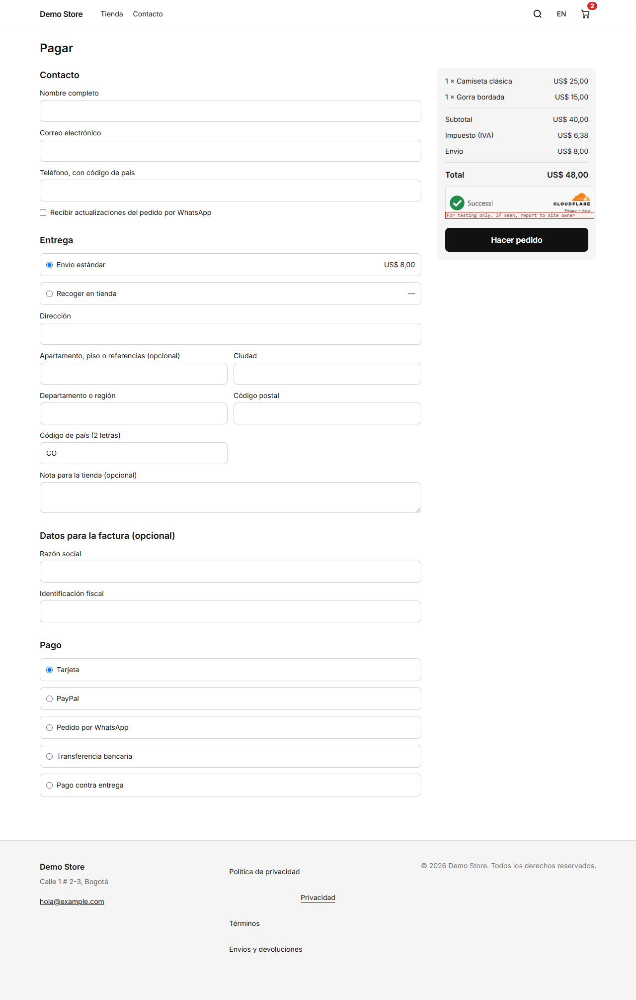

## El carrito

El carrito vive en el navegador de quien compra, así que sobrevive si cierra la pestaña. El servidor **vuelve a calcular el precio
de cada línea** antes de mostrar un total, de modo que un cambio de precio hecho en el panel se refleja y nadie puede alterar un
precio editando su navegador. Se pueden cambiar cantidades (hasta 20 por línea) o quitar productos. Se muestra el impuesto; el
envío se calcula al pagar, porque depende de la entrega elegida.

## Pagar

El pago es una sola página.

1. **Contacto:** nombre completo, correo y un teléfono con código de país. Una casilla pregunta si quiere recibir actualizaciones
   por WhatsApp (el dueño puede dejarla marcada por defecto en la [configuración de pago](/admin/settings/)).
2. **Entrega:** los métodos de envío que el dueño configuró, cada uno con su precio. Elegir **Recogida en tienda** oculta la
   dirección.
3. **Dirección:** calle, apartamento o referencias, ciudad, departamento o región, código postal y país.
4. **Datos para la factura (opcional):** razón social e identificación fiscal, para quien necesita factura a nombre de una empresa.
5. **Pago:** los métodos que el dueño tiene activados.
6. **Resumen y Hacer pedido.** El total se comprueba de nuevo en el servidor al crear el pedido.

Una comprobación anti-bots (Cloudflare Turnstile) se ejecuta en segundo plano, así que no se pide resolver acertijos.

## Métodos de pago

| Método                    | Qué ve quien compra                                                                   | Cuándo el pedido pasa a **Pagado**                      |
| ------------------------- | ------------------------------------------------------------------------------------- | ------------------------------------------------------- |
| **Tarjeta** (dLocal Go)   | Lo lleva a la página segura de dLocal Go para poner la tarjeta y lo devuelve a la tienda. | Automáticamente, cuando dLocal Go lo confirma.          |
| **PayPal**                | Lo lleva a PayPal para aprobar y lo devuelve a la tienda.                             | Automáticamente, cuando la tienda captura el pago.      |
| **Pedido por WhatsApp**   | Se abre un chat con el resumen del pedido para acordar el pago con la tienda.          | Lo marca el dueño en el panel.                          |
| **Transferencia bancaria**| La página del pedido muestra los datos bancarios que escribió el dueño.                | Lo marca el dueño cuando llega la transferencia.        |
| **Pago contra entrega**   | La página del pedido muestra la nota del dueño (por ejemplo «paga en efectivo o con tarjeta al recibir»). | Lo marca el dueño al entregar.            |

Los pagos con tarjeta y PayPal los confirma el propio proveedor llamando a la tienda, así que un pedido se marca como pagado
aunque la persona cierre el navegador justo después de pagar. La tienda nunca ve los números de tarjeta.

## Qué pasa con el stock

La tienda **reserva el stock** de un pago online pendiente durante un tiempo (45 minutos por defecto). Si no se paga, el pedido
vence y el stock se libera. Si dos personas van por la última unidad, la segunda ve un aviso amable («algunos productos ya no tienen
esa cantidad disponible») en lugar de un pedido sobrevendido.
