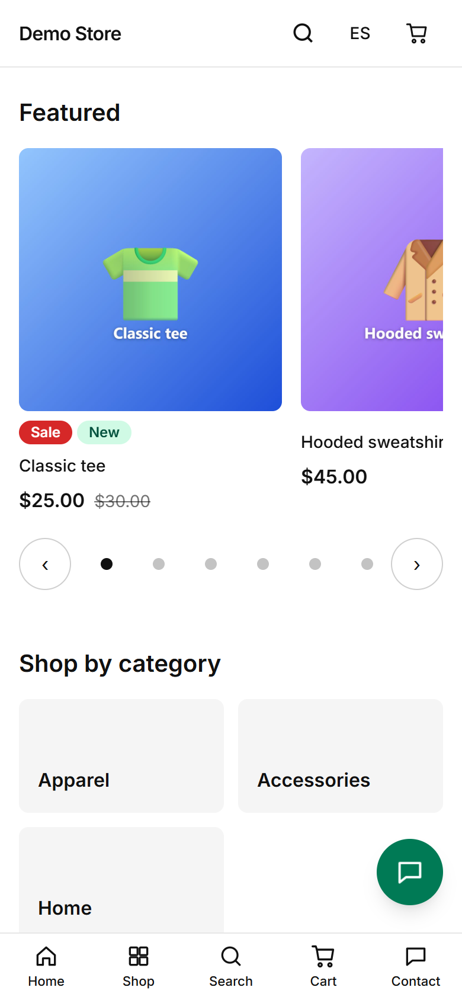

Esto es lo que vive quien compra. Cada paso tiene su propia página con capturas.

| Paso                      | Qué ocurre                                                                           | Página                                          |
| ------------------------- | ------------------------------------------------------------------------------------ | ----------------------------------------------- |
| 1. Llega                  | La página de inicio muestra productos destacados, categorías, ventajas y opiniones.   | [Explorar](/storefront/browsing/)               |
| 2. Busca un producto      | Categorías, filtros, orden y un buscador que sugiere mientras se escribe.             | [Explorar](/storefront/browsing/)               |
| 3. Elige una opción       | La ficha muestra precio, disponibilidad, tallas, colores y fotos.                     | [Explorar](/storefront/browsing/)               |
| 4. Carrito                | Los productos se guardan en el navegador, así que puede irse y volver.                | [Carrito y pago](/storefront/cart-checkout/)    |
| 5. Pago                   | Contacto, entrega, datos de factura y uno de hasta cinco métodos de pago.             | [Carrito y pago](/storefront/cart-checkout/)    |
| 6. Sigue su pedido        | Una página privada del pedido, correos y la factura cuando se paga.                   | [Después del pedido](/storefront/after-the-order/) |
| 7. Hace una pregunta      | Un formulario de contacto y un botón de WhatsApp si la tienda lo usa.                 | [Después del pedido](/storefront/after-the-order/) |

## Pensada para el celular

La mayoría de quienes compran usan el celular, así que la tienda se diseña primero a 360 px de ancho. Los botones miden al menos
44 px de alto, los formularios muestran el teclado adecuado para cada campo y las animaciones se detienen para quien pide al
celular que reduzca el movimiento.

## Dos idiomas

La cabecera tiene un cambio de idioma. Mantiene a la persona en la misma página en el otro idioma, incluidas las direcciones de
productos y categorías, que están escritas en cada idioma. Los correos se envían en el idioma que usó al hacer el pedido.

